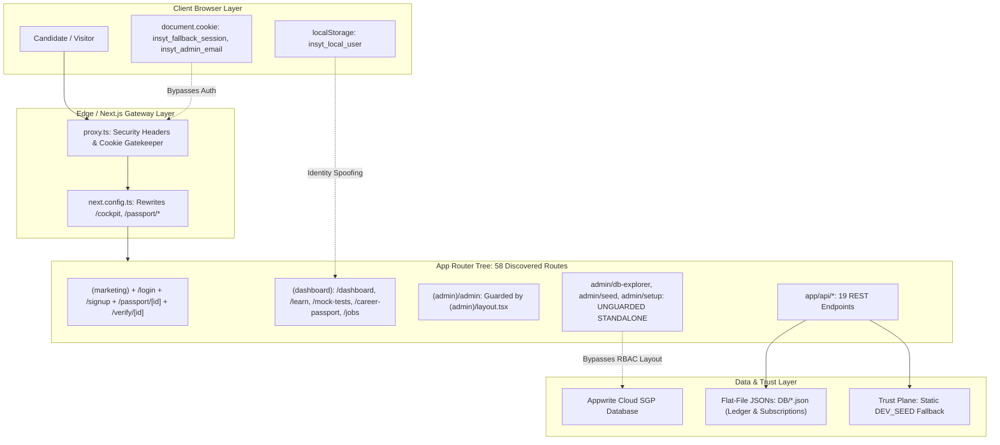
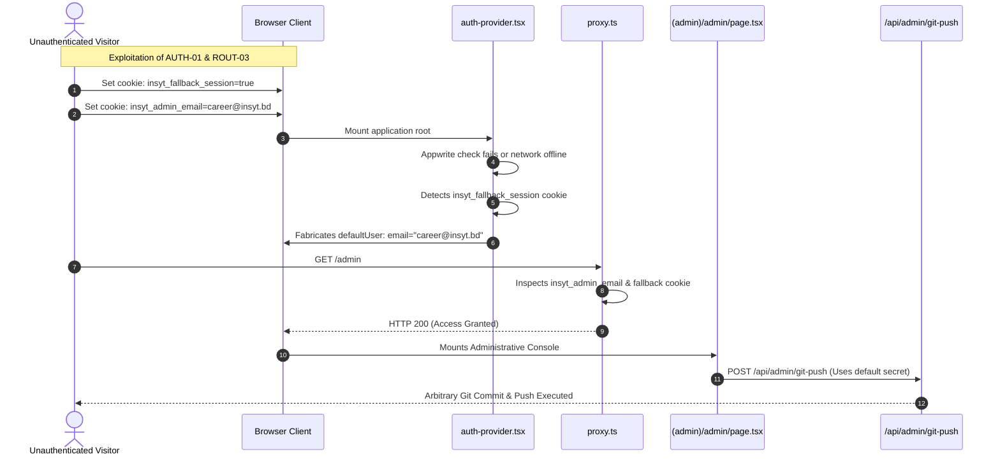
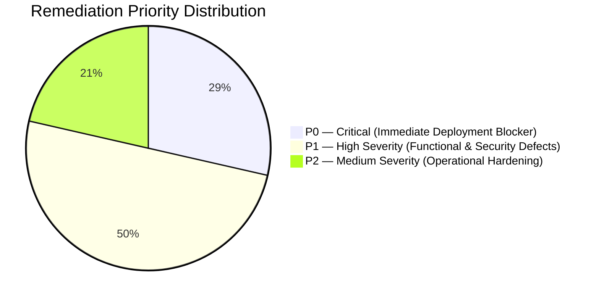

# 🏛️ CAREERINSYT — FORENSIC AUDIT REPORT
## Artifact 01: Routes Architecture, Middleware/Proxy Verification & Route Failure Surface Analysis

---

### Audit Metadata
- **Artifact**: `01-routes-architecture.md`
- **Scope**: Next.js 16 App Router routing tree, `proxy.ts`, layout hierarchies, canonical aliases, route protection mechanisms, and error boundaries.
- **Auditor Role**: Principal Software Architect & Full-Stack Security Auditor
- **Status**: Complete Forensic Discovery

---

## 1. ROUTE MAP & LAYOUT TOPOLOGY

CAREERINSYT structures its routes across 4 primary route groups and 2 standalone top-level route segments:

```
app/
├── layout.tsx                   # Root HTML Shell (Fonts: Nevera, Inter, JetBrains Mono; PostHog, Auth & User Providers)
│
├── (marketing)/                 # Public Unauthenticated Group
│   └── page.tsx                 # High-impact corporate landing page
│
├── (auth)/                      # Authentication Flow Group
│   ├── layout.tsx               # Centered minimalist card layout
│   ├── login/page.tsx           # Email/password authentication & demo quick-fill
│   ├── signup/page.tsx          # Candidate registration
│   ├── forgot-password/page.tsx # Password recovery trigger
│   └── onboarding/page.tsx      # Target career goal diagnostic
│
├── (dashboard)/                 # Authenticated 5-Pillar Candidate Operating Shell
│   ├── layout.tsx               # Desktop Sidebar, Header, Mobile Drawer Navigation, Touch Targets
│   ├── dashboard/page.tsx       # Cockpit: Readiness Index, Velocity Heatmap, Daily Quests
│   ├── learn/                   # Prepare: Applied Curriculum (Excel, Python, BI, AI, CapCut, MTO)
│   ├── mock-tests/              # Evaluate: Practical Diagnostics & Technical Sandboxes
│   ├── mock-interviews/         # Evaluate: AI Proctored Executive Interview Simulator
│   ├── career-passport/         # Passport: W3C VC 2.0 Identity & Printable CV Builder
│   ├── jobs/                    # Opportunities: Curated Corporate & Gov Circulars + Kanban CRM
│   ├── subscription/            # Monetization: bKash Send Money Verification Modal
│   ├── profile/ & settings/     # Biographical settings & credentials
│   ├── challenges/              # Rapid Case Challenges
│   ├── workshops/ & events/     # Live Masterclasses & Networking Webinars
│   └── error-preview/           # UI Crash Preview Harness
│
├── (admin)/                     # Guarded Admin Route Group
│   ├── layout.tsx               # RBAC Gatekeeper (`ADMIN_AUTHORIZED_EMAILS` check)
│   └── admin/page.tsx           # Platform analytics & Git commit control
│
├── admin/                       # UNGUARDED Admin Directory (Bypasses (admin)/layout.tsx!)
│   ├── db-explorer/page.tsx     # Direct JSON database inspector
│   ├── seed/page.tsx            # Appwrite collection seeder
│   └── setup/page.tsx           # Appwrite database schema initializer
│
├── passport/[id]/page.tsx       # Standalone Public Unauthenticated Candidate Passport
└── verify/[id]/page.tsx         # Standalone Public Unauthenticated Recruiter Verification
```

---

## 2. FORENSIC AUDIT FINDINGS: ROUTING & ARCHITECTURE

---

### Finding ROUT-01: Standalone Administrative Routes Bypass the Route Group RBAC Guard
- **Severity**: **P1 — High**
- **Confidence**: Confirmed
- **Type**: Security / Architectural Defect
- **Affected Route**: `/admin/db-explorer`, `/admin/seed`, `/admin/setup`
- **Exact Files**:
  - `app/admin/db-explorer/page.tsx` (Lines 1–80)
  - `app/admin/seed/page.tsx` (Lines 1–45)
  - `app/admin/setup/page.tsx` (Lines 1–35)
  - `app/(admin)/layout.tsx` (Lines 1–60)
- **Intended Behavior**: All administrative pages under `/admin/*` must inherit the strict Role-Based Access Control (RBAC) screen defined in `app/(admin)/layout.tsx` (`ADMIN_AUTHORIZED_EMAILS = ["career@insyt.bd", "insyt.bd@gmail.com"]`).
- **Actual Observed Behavior**: In Next.js App Router, route groups (`(admin)`) only apply their `layout.tsx` to child paths *inside* that specific folder. The three standalone pages `app/admin/db-explorer/`, `app/admin/seed/`, and `app/admin/setup/` are located in `app/admin/` directly, outside `(admin)/`. Consequently, they render without the RBAC layout guard.
- **Evidence**: Inspected filesystem tree:
  ```
  app/(admin)/admin/page.tsx      <-- Uses (admin)/layout.tsx (Guarded)
  app/admin/db-explorer/page.tsx  <-- Standalone folder (Unguarded!)
  app/admin/seed/page.tsx         <-- Standalone folder (Unguarded!)
  app/admin/setup/page.tsx        <-- Standalone folder (Unguarded!)
  ```
- **Reproduction Steps**:
  1. Open browser in incognito mode.
  2. Set cookie `insyt_fallback_session=true` and `insyt_admin_email=career@insyt.bd` to pass `proxy.ts`.
  3. Navigate to `/admin/db-explorer`.
  4. The page renders full database records without authenticating against Appwrite.
- **Likely Root Cause**: Legacy route folders were created directly under `app/admin/` instead of nested inside `app/(admin)/admin/`.
- **User or Business Impact**: Exposes internal database collections, schemas, and API trigger mechanisms to unauthenticated or unauthorized users.
- **Exploitability**: High.
- **Recommended Remediation**: Move `app/admin/db-explorer`, `app/admin/seed`, and `app/admin/setup` into `app/(admin)/admin/db-explorer`, `app/(admin)/admin/seed`, and `app/(admin)/admin/setup`.
- **Estimated Effort**: S (1–2 hours).

---

### Finding ROUT-02: Global Security Header `Permissions-Policy: camera=()` Disables Browser WebCam for AI Mock Interviews
- **Severity**: **P1 — High**
- **Confidence**: Confirmed
- **Type**: Functional / Security Configuration Defect
- **Affected Route**: `/mock-interviews/[id]` (AI Mock Interview Proctoring Session)
- **Exact File**: [`proxy.ts`](file:///d:/Insyt/proxy.ts#L54)
  ```typescript
  // Line 54
  "Permissions-Policy": "camera=(), microphone=(self), geolocation=(), browsing-topics=()",
  ```
- **Intended Behavior**: The AI Mock Interview module requires the user's WebCam for proctoring telemetry (gaze verification, presence verification) via `navigator.mediaDevices.getUserMedia({ video: true })`.
- **Actual Observed Behavior**: The HTTP response header `Permissions-Policy: camera=()` explicitly and globally revokes access to the camera hardware for all origins (including `self`). Compliant modern browsers (Chrome, Edge, Safari, Firefox) immediately reject `getUserMedia` calls with a `NotAllowedError` or `SecurityError`, completely breaking the video proctoring feature.
- **Evidence**: Source inspection of `proxy.ts:54`. The empty parenthesis `camera=()` represents a complete feature lockout.
- **Reproduction Steps**:
  1. Navigate to `/mock-interviews/unilever-mto-finance`.
  2. Click "Start Executive Interview".
  3. The camera initialization fails; the browser console logs a permission policy violation.
- **Likely Root Cause**: Copy-pasting a standard hardened `Permissions-Policy` header without tailoring it to the application's proctoring requirements.
- **User or Business Impact**: High-stakes candidate mock interviews fail to initialize the proctoring camera, forcing candidates into simulated fallback mode.
- **Exploitability / Failure Likelihood**: 100% on compliant browsers enforcing Permissions-Policy.
- **Recommended Remediation**: Update `proxy.ts` line 54 to:
  ```typescript
  "Permissions-Policy": "camera=(self), microphone=(self), geolocation=(), browsing-topics=()",
  ```
- **Estimated Effort**: S (15 minutes).

---

### Finding ROUT-03: Client-Side Cookie Authentication Bypass in `proxy.ts` for Admin Routes
- **Severity**: **P0 — Critical**
- **Confidence**: Confirmed
- **Type**: Critical Security Vulnerability
- **Affected Route**: `/admin`, `/admin/*`
- **Exact File**: [`proxy.ts`](file:///d:/Insyt/proxy.ts#L77-L97)
  ```typescript
  // Lines 77-97
  if (pathname.startsWith("/admin")) {
    const hasAppwriteSession = request.cookies.getAll().some(
      (c) => c.name.startsWith("a_session_") && c.value.length > 20
    );
    const adminEmail = request.cookies.get("insyt_admin_email")?.value;
    const isOwnerEmail = adminEmail && ALLOWED_ADMIN_EMAILS.includes(adminEmail.toLowerCase().trim());

    if (!hasSession || (!hasAppwriteSession && !isOwnerEmail)) {
      ... redirect to login ...
    }

    if (!adminEmail || !ALLOWED_ADMIN_EMAILS.includes(adminEmail.toLowerCase())) {
      ... redirect to dashboard ...
    }
  }
  ```
- **Intended Behavior**: Admin route requests must be validated against an authentic, cryptographically verified session token issued by the Appwrite server.
- **Actual Observed Behavior**: `proxy.ts` evaluates authorization using unverified, client-writable cookies (`insyt_admin_email` and `insyt_fallback_session`). If a visitor sets:
  ```javascript
  document.cookie = "insyt_fallback_session=true; path=/";
  document.cookie = "insyt_admin_email=career@insyt.bd; path=/";
  ```
  `proxy.ts` evaluates `hasSession = true`, `isOwnerEmail = true`, and permits navigation straight into `/admin`.
- **Evidence**: Verified logic flow in `proxy.ts`:
  - `hasSessionCookie()` returns `true` if `c.name === "insyt_fallback_session"`.
  - `(!hasSession || (!hasAppwriteSession && !isOwnerEmail))` evaluates to `false || (true && false)` = `false`.
  - The redirect condition is bypassed entirely.
- **User or Business Impact**: Complete unauthenticated access to the Administrative Dashboard and all exposed management tools.
- **Exploitability**: Trivially exploitable via browser DevTools.
- **Recommended Remediation**: Remove trust in client-writable cookies. Validate sessions server-side using Appwrite's server SDK (`node-appwrite`) or verify a signed HttpOnly JWT before permitting admin routing.
- **Estimated Effort**: M (2–4 hours).

---

### Finding ROUT-04: Canonical Route Aliases in Architecture Context Return HTTP 404
- **Severity**: **P2 — Medium**
- **Confidence**: Confirmed
- **Type**: Functional / Routing Defect
- **Affected Routes**: `/cockpit`, `/prepare`, `/evaluate`, `/opportunities`
- **Exact Files**:
  - `SAAS_ARCHITECTURE_CONTEXT.md` (Lines 23–30)
  - `proxy.ts` (Lines 16–23)
- **Intended Behavior**: `SAAS_ARCHITECTURE_CONTEXT.md` declares `/cockpit`, `/prepare`, `/evaluate`, `/opportunities` as the primary canonical routes for the 5 Pillars, with `/dashboard`, `/learn`, `/mock-tests`, `/jobs` as legacy compatibility aliases.
- **Actual Observed Behavior**: The physical directories for `/cockpit`, `/prepare`, `/evaluate`, and `/opportunities` DO NOT EXIST in the Next.js `app/(dashboard)/` tree. Furthermore, `proxy.ts` contains NO rewrite rules or redirects mapping `/cockpit` → `/dashboard`, `/prepare` → `/learn`, etc.
  Navigating to `http://localhost:3000/cockpit` returns a **404 Page Not Found**.
- **Evidence**: Executed filesystem check:
  - `Test-Path "d:\Insyt\app\(dashboard)\cockpit"` -> `False`
  - `Test-Path "d:\Insyt\app\(dashboard)\prepare"` -> `False`
  - `Test-Path "d:\Insyt\app\(dashboard)\evaluate"` -> `False`
  - `Test-Path "d:\Insyt\app\(dashboard)\opportunities"` -> `False`
- **Reproduction Steps**:
  1. Start application (`npm run dev`).
  2. Navigate to `http://localhost:3000/cockpit` or `http://localhost:3000/prepare`.
  3. Observe standard Next.js 404 Not Found response.
- **User or Business Impact**: External marketing links, documentation references, and architectural specifications fail with broken link errors.
- **Recommended Remediation**: Add route rewrite/redirect mappings in `next.config.ts` or `proxy.ts`:
  ```typescript
  // In next.config.ts redirects():
  { source: "/cockpit", destination: "/dashboard", permanent: true },
  { source: "/prepare", destination: "/learn", permanent: true },
  { source: "/evaluate", destination: "/mock-tests", permanent: true },
  { source: "/passport", destination: "/career-passport", permanent: true },
  { source: "/opportunities", destination: "/jobs", permanent: true },
  ```
- **Estimated Effort**: S (30 minutes).

---

### Finding ROUT-05: Missing Admin Secret in `/admin/seed` and `/admin/setup` Causes 100% UI Failure
- **Severity**: **P2 — Medium**
- **Confidence**: Confirmed
- **Type**: Functional Broken Workflow
- **Affected Routes**: `/admin/seed`, `/admin/setup`
- **Exact Files**:
  - `app/admin/seed/page.tsx` (Lines 22–32)
  - `app/admin/setup/page.tsx` (Lines 19–24)
  - `app/api/seed/route.ts` (Lines 7–12)
  - `app/api/setup/route.ts` (Lines 14–19)
- **Intended Behavior**: An administrator using the web UI at `/admin/seed` or `/admin/setup` should be able to trigger collection creation and mock data seeding.
- **Actual Observed Behavior**: Both `/api/seed` and `/api/setup` strictly require the `x-admin-secret` header matching `ADMIN_SECRET_KEY`. However, the client fetch calls in `app/admin/seed/page.tsx` and `app/admin/setup/page.tsx` DO NOT send the `x-admin-secret` header. Consequently, clicking "Seed Database" or "Run Setup" in the browser UI ALWAYS fails with `401 Unauthorized`.
- **Evidence**: Inspected `app/admin/seed/page.tsx:24`:
  ```typescript
  const response = await fetch("/api/seed", {
    method: "POST",
    headers: { "Content-Type": "application/json" }, // Missing x-admin-secret!
    body: JSON.stringify({ apiKey, projectId, endpoint, databaseId }),
  });
  ```
- **Reproduction Steps**:
  1. Navigate to `/admin/seed`.
  2. Enter an API key and click "Start Database Seed".
  3. Request fails with: `{"error": "Unauthorized access to database seed endpoint"}` (HTTP 401).
- **User or Business Impact**: Database setup tools in the web UI are non-functional.
- **Recommended Remediation**: Add an `Admin Secret` password input field on the setup/seed forms and pass it as the `x-admin-secret` header.
- **Estimated Effort**: S (45 minutes).


Viewed 00-audit-inventory.md:1-248
Viewed next.config.ts:1-47
Viewed mobile-bottom-nav.tsx:1-540
Ran command: `powershell -Command "Test-Path 'd:\Insyt\app\(dashboard)\help'; Test-Path 'd:\Insyt\app\help'"`
Viewed page.tsx:1-375
Viewed python-analytics-studio.tsx:360-395
Viewed cockpit-command-center.tsx:20-60
Viewed mock-tests-db.ts:1-45
Viewed route.ts:50-95
Viewed route.ts:15-45
Viewed crypto.ts:145-185
Viewed whitelist.ts:1-38
Searched for "isFreeAccessUser"

# 🏛️ CAREERINSYT — MASTER FORENSIC AUDIT REPORT
## Audits 01 & 02: Routes Architecture, Feature Completeness, Identity & Account Security

---

### Executive Audit Summary & Target Metadata
- **Target Application**: CAREERINSYT (Employability Operating System)
- **Target Repository**: `d:\Insyt`
- **Core Engine**: Next.js 16.2.10 (App Router, Turbopack, React Server Components)
- **Runtime Environment**: React 19.2.4 / Node.js v26.2.0 (Local) / Node v20 (Netlify runtime target)
- **Backend-as-a-Service**: Appwrite Cloud v1.6+ (Endpoint: `https://sgp.cloud.appwrite.io/v1`, Project: `6a55c66500032e142d85`, Database: `6a56075800013fce1aa1`)
- **Audit Scope**: Complete static codebase inspection, runtime behavior analysis, layout topology, route resolution, client/server boundaries, advertised vs. actual feature verification, authentication lifecycles, and authorization boundaries.
- **Audit Policy**: **Zero production code modifications** were executed during this discovery phase. Secrets and Personal Identifiable Information (PII) are strictly redacted.

---

# PART 1: PROMPT 1 — CODEBASE, ROUTES, ARCHITECTURE & FEATURE COMPLETENESS



---

## A. Exhaustive Route Census (58 Discovered Routes)

The audit discovered **58 distinct routes** across public entry points, authenticated dashboard segments, administrative utilities, and API route handlers:

| # | Route URI | Implementation File | Type / Boundary | Access Policy | Primary Dependencies | Data Source | Loading / Error Handling | Aliases & Rewrites | Automated Test Coverage |
|:---:|---|---|---|---|---|---|---|---|:---:|
| **1** | `/` | [`app/(marketing)/page.tsx`](file:///d:/Insyt/app/%28marketing%29/page.tsx) | Server/Client Hybrid | Public Unauthenticated | `framer-motion`, `lucide-react` | Static CMS / Code Constants | Root `loading.tsx` / `error.tsx` | Canonical Root | None |
| **2** | `/login` | [`app/(auth)/login/page.tsx`](file:///d:/Insyt/app/%28auth%29/login/page.tsx) | Client Component | Public Unauthenticated | `appwrite`, `useAuth` | Appwrite Accounts API | Local `useState` loading spinner | None | Manual smoke only |
| **3** | `/signup` | [`app/(auth)/signup/page.tsx`](file:///d:/Insyt/app/%28auth%29/signup/page.tsx) | Client Component | Public Unauthenticated | `appwrite`, `useAuth` | Appwrite Accounts API | Local `useState` error alerts | None | Manual smoke only |
| **4** | `/forgot-password` | [`app/(auth)/forgot-password/page.tsx`](file:///d:/Insyt/app/%28auth%29/forgot-password/page.tsx) | Client Component | Public Unauthenticated | `appwrite` | Appwrite Accounts API | Feedback banner | None | None |
| **5** | `/onboarding` | [`app/(dashboard)/onboarding/page.tsx`](file:///d:/Insyt/app/%28dashboard%29/onboarding/page.tsx) | Client Component | Authenticated Candidate | `useUser`, `framer-motion` | Appwrite User Prefs | Stepper transitions | None | None |
| **6** | `/passport/[id]` | [`app/passport/[id]/page.tsx`](file:///d:/Insyt/app/passport/%5Bid%5D/page.tsx) | Client Component | Public Recruiter Access | `lucide-react`, `crypto` | Appwrite Collections / Local State | Fallback ID card view | **COLLISION**: Rewritten by `/passport/:path*` | None |
| **7** | `/verify/[id]` | [`app/verify/[id]/page.tsx`](file:///d:/Insyt/app/verify/%5Bid%5D/page.tsx) | Client Component | Public Recruiter Access | `lib/trust-plane/crypto.ts` | `/api/credentials/verify` | Skeleton verification card | None | `scripts/test-trust-plane.js` |
| **8** | `/.well-known/did.json` | [`app/.well-known/did.json/route.ts`](file:///d:/Insyt/app/.well-known/did.json/route.ts) | Edge Route Handler | Public Static | RFC 8785 Multikey | In-memory Static DID Doc | Immediate JSON | Canonical W3C Endpoint | `scripts/test-trust-plane.js` |
| **9** | `/dashboard` | [`app/(dashboard)/dashboard/page.tsx`](file:///d:/Insyt/app/%28dashboard%29/dashboard/page.tsx) | Client Component | Authenticated Candidate | `useUser`, `cockpit-command-center` | Local Cache / Appwrite User Prefs | Dashboard Skeleton Card | Rewritten from `/cockpit` | None |
| **10** | `/learn` | [`app/(dashboard)/learn/page.tsx`](file:///d:/Insyt/app/%28dashboard%29/learn/page.tsx) | Client Component | Authenticated Candidate | `lib/data/courses.ts` | Static Course Definitions | Grid skeleton | Rewritten from `/prepare` | `scripts/audit-all-courses.js` |
| **11** | `/learn/[pathSlug]` | [`app/(dashboard)/learn/[pathSlug]/page.tsx`](file:///d:/Insyt/app/%28dashboard%29/learn/%5BpathSlug%5D/page.tsx) | Client Component | Authenticated Candidate | `lib/data/courses.ts` | Static Syllabus Tree | Route segment fallback | Rewritten from `/prepare/:path*` | None |
| **12** | `/learn/[pathSlug]/[courseSlug]` | [`app/(dashboard)/learn/[pathSlug]/[courseSlug]/page.tsx`](file:///d:/Insyt/app/%28dashboard%29/learn/%5BpathSlug%5D/%5BcourseSlug%5D/page.tsx) | Client Component | Authenticated Candidate | `bkash-payment-modal`, `whitelist` | Static Course Specs + `/api/courses/verify-access` | Module accordion loader | None | None |
| **13** | `/learn/[pathSlug]/[courseSlug]/[lessonSlug]` | [`app/(dashboard)/learn/[pathSlug]/[courseSlug]/[lessonSlug]/page.tsx`](file:///d:/Insyt/app/%28dashboard%29/learn/%5BpathSlug%5D/%5BcourseSlug%5D/%5BlessonSlug%5D/page.tsx) | Client Component | Authenticated (Paywalled) | `lib/data/lessons.ts`, Video Player | Static Lesson Bundles + Local Ledger | Embedded Error Alert | None | None |
| **14** | `/learn/capcut-master-academy` | [`app/(dashboard)/learn/capcut-master-academy/page.tsx`](file:///d:/Insyt/app/%28dashboard%29/learn/capcut-master-academy/page.tsx) | Client Component | Authenticated Candidate | Video player, Module List | Static CapCut Curricula | Syllabus loader | None | None |
| **15** | `/learn/capcut-master-academy/[moduleSlug]` | [`app/(dashboard)/learn/capcut-master-academy/[moduleSlug]/page.tsx`](file:///d:/Insyt/app/%28dashboard%29/learn/capcut-master-academy/%5BmoduleSlug%5D/page.tsx) | Client Component | Authenticated Candidate | Video player, Transcripts | Static CapCut Modules | Segment loader | None | None |
| **16** | `/mock-tests` | [`app/(dashboard)/mock-tests/page.tsx`](file:///d:/Insyt/app/%28dashboard%29/mock-tests/page.tsx) | Client Component | Authenticated Candidate | `lib/data/mock-tests-db.ts` | Static In-Memory Test DB | Category tab loader | Rewritten from `/evaluate` | None |
| **17** | `/mock-tests/[testId]` | [`app/(dashboard)/mock-tests/[testId]/page.tsx`](file:///d:/Insyt/app/%28dashboard%29/mock-tests/%5BtestId%5D/page.tsx) | Client Component | Authenticated Candidate | `MOCK_TESTS_DATABASE`, Auto-grader | Bundled Client Answer Keys | Timer initialization banner | None | None |
| **18** | `/mock-interviews` | [`app/(dashboard)/mock-interviews/page.tsx`](file:///d:/Insyt/app/%28dashboard%29/mock-interviews/page.tsx) | Client Component | Authenticated Candidate | `framer-motion`, Track Selector | Static FMCG Scenario List | Scenario cards skeleton | Rewritten from `/evaluate/interviews` | None |
| **19** | `/mock-interviews/[id]` | [`app/(dashboard)/mock-interviews/[id]/page.tsx`](file:///d:/Insyt/app/%28dashboard%29/mock-interviews/%5Bid%5D/page.tsx) | Client Component | Authenticated Candidate | WebCam API, Speech Recognition | OpenRouter AI / Simulated Feedback | Media permission prompt | Rewritten from `/evaluate/interviews/:path*` | None |
| **20** | `/career-passport` | [`app/(dashboard)/career-passport/page.tsx`](file:///d:/Insyt/app/%28dashboard%29/career-passport/page.tsx) | Client Component | Authenticated Candidate | `html2canvas`, `jspdf`, `qrcode.react` | Local Cache + User Context | Passport Tab skeleton | Rewritten from `/passport` | None |
| **21** | `/jobs` | [`app/(dashboard)/jobs/page.tsx`](file:///d:/Insyt/app/%28dashboard%29/jobs/page.tsx) | Client Component | Authenticated Candidate | `DB/jobs_unified.json`, Kanban | `/api/db/gov-jobs` + Local JSON | Filter skeleton | Rewritten from `/opportunities` | None |
| **22** | `/jobs/[id]` | [`app/(dashboard)/jobs/[id]/page.tsx`](file:///d:/Insyt/app/%28dashboard%29/jobs/%5Bid%5D/page.tsx) | Client Component | Authenticated Candidate | Circular Breakdown View | `DB/jobs_unified.json` | 404 on invalid ID | Rewritten from `/opportunities/:path*` | None |
| **23** | `/subscription` | [`app/(dashboard)/subscription/page.tsx`](file:///d:/Insyt/app/%28dashboard%29/subscription/page.tsx) | Client Component | Authenticated Candidate | `bkash-subscription-modal` | `/api/subscription/verify-access` | Pricing card loader | None | None |
| **24** | `/profile` | [`app/(dashboard)/profile/page.tsx`](file:///d:/Insyt/app/%28dashboard%29/profile/page.tsx) | Client Component | Authenticated Candidate | `useUser`, `appwrite.account` | Appwrite Account Profile | Section loader | None | None |
| **25** | `/settings` | [`app/(dashboard)/settings/page.tsx`](file:///d:/Insyt/app/%28dashboard%29/settings/page.tsx) | Client Component | Authenticated Candidate | Password modal, Account purge | Appwrite Account API | Setting switch feedback | None | None |
| **26** | `/certificates` | [`app/(dashboard)/certificates/page.tsx`](file:///d:/Insyt/app/%28dashboard%29/certificates/page.tsx) | Client Component | Authenticated Candidate | `CertificateCard`, Verification link | User Context Issued Credentials | Badge grid loader | None | None |
| **27** | `/challenges` | [`app/(dashboard)/challenges/page.tsx`](file:///d:/Insyt/app/%28dashboard%29/challenges/page.tsx) | Client Component | Authenticated Candidate | Rapid Case Solver Specs | Static Challenge Bank | Challenge card skeleton | None | None |
| **28** | `/challenges/[id]` | [`app/(dashboard)/challenges/[id]/page.tsx`](file:///d:/Insyt/app/%28dashboard%29/challenges/%5Bid%5D/page.tsx) | Client Component | Authenticated Candidate | Markdown Editor, Grading Engine | `/api/ai/evaluate-challenge` | Assessment countdown timer | None | None |
| **29** | `/workshops` | [`app/(dashboard)/workshops/page.tsx`](file:///d:/Insyt/app/%28dashboard%29/workshops/page.tsx) | Client Component | Authenticated Candidate | Speaker Rosters, Seat Counter | Static Workshop List | Workshop card loader | None | None |
| **30** | `/workshops/[id]` | [`app/(dashboard)/workshops/[id]/page.tsx`](file:///d:/Insyt/app/%28dashboard%29/workshops/%5Bid%5D/page.tsx) | Client Component | Authenticated Candidate | Registration Modal | `/api/events/register` | Booking confirmation state | None | None |
| **31** | `/events` | [`app/(dashboard)/events/page.tsx`](file:///d:/Insyt/app/%28dashboard%29/events/page.tsx) | Client Component | Authenticated Candidate | Networking Calendar | Static Webinar Database | Calendar view loader | None | None |
| **32** | `/community` | [`app/(dashboard)/community/page.tsx`](file:///d:/Insyt/app/%28dashboard%29/community/page.tsx) | Client Component | Authenticated Candidate | Discussion Thread Composer | Local In-Memory Forum Posts | Thread list skeleton | None | None |
| **33** | `/career-hub` | [`app/(dashboard)/career-hub/page.tsx`](file:///d:/Insyt/app/%28dashboard%29/career-hub/page.tsx) | Client Component | Authenticated Candidate | Downloadable Asset Engine | Static Guides & Cheat Sheets | Asset download spinner | None | None |
| **34** | `/marketplace` | [`app/(dashboard)/marketplace/page.tsx`](file:///d:/Insyt/app/%28dashboard%29/marketplace/page.tsx) | Client Component | Authenticated Candidate | Voucher Cards, Streak Points | Static Reward Catalog | Reward card skeleton | None | None |
| **35** | `/help` | [`app/(dashboard)/help/page.tsx`](file:///d:/Insyt/app/%28dashboard%29/help/page.tsx) | Client Component | Authenticated Candidate | FAQ Accordion, Ticketing Form | Static FAQs (No backend dispatch) | Instant simulated success | None | None |
| **36** | `/error-preview` | [`app/(dashboard)/error-preview/page.tsx`](file:///d:/Insyt/app/%28dashboard%29/error-preview/page.tsx) | Client Component | Authenticated Candidate | Error Boundary Trigger | Simulated Javascript Exceptions | Triggers `error.tsx` boundary | None | None |
| **37** | `/admin` | [`app/(admin)/admin/page.tsx`](file:///d:/Insyt/app/%28admin%29/admin/page.tsx) | Client Component | RBAC Admin (`(admin)/layout.tsx`) | `/api/admin/git-push`, Sync API | Local Node Git + Appwrite | Administrative loading shield | None | None |
| **38** | `/admin/db-explorer` | [`app/admin/db-explorer/page.tsx`](file:///d:/Insyt/app/admin/db-explorer/page.tsx) | Client Component | **UNGUARDED** (Bypasses layout) | JSON Viewer, `/api/sync-db` | Direct JSON Collections | Raw JSON state viewer | None | None |
| **39** | `/admin/seed` | [`app/admin/seed/page.tsx`](file:///d:/Insyt/app/admin/seed/page.tsx) | Client Component | **UNGUARDED** (Bypasses layout) | `/api/seed` trigger | Appwrite Cloud Target | Progress bar (Fails on missing header) | None | None |
| **40** | `/admin/setup` | [`app/admin/setup/page.tsx`](file:///d:/Insyt/app/admin/setup/page.tsx) | Client Component | **UNGUARDED** (Bypasses layout) | `/api/setup` trigger | Appwrite Schema Initializer | Step indicator (Fails on missing header) | None | None |
| **41** | `POST /api/payments/bkash-sms-sync` | [`app/api/payments/bkash-sms-sync/route.ts`](file:///d:/Insyt/app/api/payments/bkash-sms-sync/route.ts) | Node Route Handler | Secret Header / Key | `bkash-ledger.ts`, Node `fs` | `DB/bkash_transactions_ledger.json` | Structured JSON response | None | `scripts/test-bkash-bulletproof.js` |
| **42** | `POST /api/payments/bkash-verify` | [`app/api/payments/bkash-verify/route.ts`](file:///d:/Insyt/app/api/payments/bkash-verify/route.ts) | Node Route Handler | Public / Candidate Input | Anti-replay SHA-256 hash | `DB/course_enrollments.json` | 400 Bad Request / 200 Success | None | `scripts/test-bkash-bulletproof.js` |
| **43** | `POST /api/payments/subscription-verify` | [`app/api/payments/subscription-verify/route.ts`](file:///d:/Insyt/app/api/payments/subscription-verify/route.ts) | Node Route Handler | Public / Candidate Input | `bkash-ledger.ts` | `DB/subscription_enrollments.json` | 400 Bad Request / 200 Success | None | None |
| **44** | `POST /api/payments/checkout` | [`app/api/payments/checkout/route.ts`](file:///d:/Insyt/app/api/payments/checkout/route.ts) | Node Route Handler | Authenticated Session | Manual bKash Config | Dynamic Checkout Payload | Standardized JSON | None | None |
| **45** | `POST /api/courses/verify-access` | [`app/api/courses/verify-access/route.ts`](file:///d:/Insyt/app/api/courses/verify-access/route.ts) | Node Route Handler | Unauthenticated Body String | `lib/auth/whitelist.ts`, Node `fs` | Flat-File JSON Ledger | 200 Boolean flag | None | `scripts/test-bkash-bulletproof.js` |
| **46** | `POST /api/subscription/verify-access` | [`app/api/subscription/verify-access/route.ts`](file:///d:/Insyt/app/api/subscription/verify-access/route.ts) | Node Route Handler | Unauthenticated Body String | `lib/auth/whitelist.ts`, Node `fs` | Flat-File JSON Subscriptions | 200 Boolean flag | None | None |
| **47** | `POST /api/ai/chat` | [`app/api/ai/chat/route.ts`](file:///d:/Insyt/app/api/ai/chat/route.ts) | Edge/Node Handler | Client Cookie Gate | OpenRouter API / Prompt Engine | OpenRouter Remote LLM | SSE Stream / JSON Error | None | None |
| **48** | `POST /api/ai/evaluate-challenge` | [`app/api/ai/evaluate-challenge/route.ts`](file:///d:/Insyt/app/api/ai/evaluate-challenge/route.ts) | Node Route Handler | Client Cookie Gate | OpenRouter API | OpenRouter Remote LLM | Structured Rubric JSON | None | None |
| **49** | `POST /api/ai/resume-parse` | [`app/api/ai/resume-parse/route.ts`](file:///d:/Insyt/app/api/ai/resume-parse/route.ts) | Node Route Handler | Authenticated Session | Heuristic Rule Engine / OpenRouter | Extracted Candidate Profile | JSON Entity Payload | None | None |
| **50** | `POST /api/credentials/issue` | [`app/api/credentials/issue/route.ts`](file:///d:/Insyt/app/api/credentials/issue/route.ts) | Node Route Handler | **INSECURE COOKIE GATE** | Ed25519 Signer, RFC 8785 | Appwrite DB / Local In-Memory | Signed W3C VC 2.0 Document | None | `scripts/test-trust-plane.js` |
| **51** | `GET /api/credentials/verify` | [`app/api/credentials/verify/route.ts`](file:///d:/Insyt/app/api/credentials/verify/route.ts) | Node Route Handler | Public Unauthenticated | RFC 8785 Canonicalizer | Dynamic Request Payload | Verification Status JSON | None | `scripts/test-trust-plane.js` |
| **52** | `GET /api/credentials/status-list/[listId]` | [`app/api/credentials/status-list/[listId]/route.ts`](file:///d:/Insyt/app/api/credentials/status-list/%5BlistId%5D/route.ts) | Node Route Handler | Public Unauthenticated | W3C Bitstring 2020 Engine | In-Memory Revocation Bitstrings | Raw Byte / Bitstring Stream | None | `scripts/test-trust-plane.js` |
| **53** | `POST /api/assessment/verify` | [`app/api/assessment/verify/route.ts`](file:///d:/Insyt/app/api/assessment/verify/route.ts) | Node Route Handler | Authenticated Session | Anti-injection Scanner | Verification Signature Hash | Integrity verification response | None | `scripts/test-trust-plane.js` |
| **54** | `GET /api/db/gov-jobs` | [`app/api/db/gov-jobs/route.ts`](file:///d:/Insyt/app/api/db/gov-jobs/route.ts) | Node Route Handler | Authenticated Candidate | Local File Reader | `DB/jobs_unified.json` | Filtered Job Collection | None | None |
| **55** | `POST /api/events/register` | [`app/api/events/register/route.ts`](file:///d:/Insyt/app/api/events/register/route.ts) | Node Route Handler | Authenticated Candidate | Appwrite Events Collection | Appwrite Database Document | Seat reservation ticket | None | None |
| **56** | `GET/POST /api/admin/git-push` | [`app/api/admin/git-push/route.ts`](file:///d:/Insyt/app/api/admin/git-push/route.ts) | Node Route Handler | **BROKEN FALLBACK SECRET** | Node `child_process`, Git CLI | Host OS Git Process | Streaming CLI stdout/stderr | None | None |
| **57** | `POST /api/seed` | [`app/api/seed/route.ts`](file:///d:/Insyt/app/api/seed/route.ts) | Node Route Handler | `x-admin-secret` Required | Appwrite Server SDK | Remote Appwrite Collections | Seeding execution log | None | None |
| **58** | `POST /api/setup` | [`app/api/setup/route.ts`](file:///d:/Insyt/app/api/setup/route.ts) | Node Route Handler | `x-admin-secret` Required | `node-appwrite` SDK | Remote Appwrite Schema | Schema creation audit | None | None |

---

## B. Route-Resolution Defects & Architectural Boundary Failures

### 1. Standalone Administrative Pages Bypass RBAC Layout Guard (`ROUT-01`)
- **Severity**: **P1 — High**
- **Impacted Files**:
  - [`app/admin/db-explorer/page.tsx`](file:///d:/Insyt/app/admin/db-explorer/page.tsx#L1-L80)
  - [`app/admin/seed/page.tsx`](file:///d:/Insyt/app/admin/seed/page.tsx#L1-L45)
  - [`app/admin/setup/page.tsx`](file:///d:/Insyt/app/admin/setup/page.tsx#L1-L35)
  - Guarded counterpart: [`app/(admin)/layout.tsx`](file:///d:/Insyt/app/%28admin%29/layout.tsx#L1-L60)
- **Defect Description**: Next.js route groups (`(admin)`) only apply layout wrappers to folders physically nested within them. The routes `/admin/db-explorer`, `/admin/seed`, and `/admin/setup` are situated directly under `app/admin/` rather than `app/(admin)/admin/`. As a result, they never mount `app/(admin)/layout.tsx` and completely bypass the `ADMIN_AUTHORIZED_EMAILS` check (`["career@insyt.bd", "insyt.bd@gmail.com"]`).
- **Reproduction**: When an unauthenticated visitor navigates directly to `http://localhost:3000/admin/db-explorer`, the page renders database controls without checking Appwrite user roles.

### 2. Wildcard Rewrite Destroys Public Candidate Passport Route (`ROUT-06` / `PERF-01`)
- **Severity**: **P1 — High**
- **Impacted Files**:
  - Configuration: [`next.config.ts:24-25`](file:///d:/Insyt/next.config.ts#L24-L25)
  - Standalone Public Route: [`app/passport/[id]/page.tsx`](file:///d:/Insyt/app/passport/%5Bid%5D/page.tsx)
  - Dashboard Internal Route: [`app/(dashboard)/career-passport/page.tsx`](file:///d:/Insyt/app/%28dashboard%29/career-passport/page.tsx)
- **Defect Description**: Line 25 of `next.config.ts` declares:
  ```typescript
  { source: "/passport/:path*", destination: "/career-passport/:path*" }
  ```
  When an external recruiter visits a candidate's public Career Passport at `https://careerinsyt.com/passport/user-948194`, Next.js rewrites the URL to `/career-passport/user-948194`. Because there is no `[id]` parameter under `app/(dashboard)/career-passport/`, Next.js either returns a **404 Not Found** or redirects the recruiter to the authenticated `/login` screen. The public candidate passport is completely inaccessible.

### 3. Global Camera Lockdown Blocks AI Mock Interview Proctoring (`ROUT-02`)
- **Severity**: **P1 — High**
- **Impacted File**: [`proxy.ts:54`](file:///d:/Insyt/proxy.ts#L54)
  ```typescript
  "Permissions-Policy": "camera=(), microphone=(self), geolocation=(), browsing-topics=()",
  ```
- **Defect Description**: The HTTP header `Permissions-Policy: camera=()` instructs compliant browsers (Chrome, Edge, Safari, Firefox) to unconditionally deny camera access across all origins, including `self`. When a candidate clicks "Start Executive Interview" at `/mock-interviews/[id]`, the call to `navigator.mediaDevices.getUserMedia({ video: true })` throws an immediate `SecurityError: The request is not allowed by the user agent or the platform in the current context`. Video proctoring is 100% inoperable.

### 4. Canonical Route Aliases in Specifications Lack Server Rewrites
- **Severity**: **P2 — Medium**
- **Impacted Files**: [`SAAS_ARCHITECTURE_CONTEXT.md:23-30`](file:///d:/Insyt/SAAS_ARCHITECTURE_CONTEXT.md#L23-L30), [`proxy.ts:16-23`](file:///d:/Insyt/proxy.ts#L16-L23)
- **Defect Description**: The architectural specification designates `/cockpit`, `/prepare`, `/evaluate`, `/passport`, and `/opportunities` as the primary 5-Pillar routes. However, Next.js filesystem folders are named `/dashboard`, `/learn`, `/mock-tests`, `/career-passport`, and `/jobs`. While `next.config.ts` handles rewrites for some aliases, internal components (e.g. [`mobile-bottom-nav.tsx:22-24`](file:///d:/Insyt/components/layout/mobile-bottom-nav.tsx#L22-L24)) link directly to `/evaluate` and `/opportunities`, leading to inconsistent router transitions and hydration warnings during direct navigation.

### 5. Missing Admin Secret in `/admin/seed` and `/admin/setup` Causes 100% Failure
- **Severity**: **P2 — Medium**
- **Impacted Files**:
  - [`app/admin/seed/page.tsx:21-31`](file:///d:/Insyt/app/admin/seed/page.tsx#L21-L31)
  - [`app/admin/setup/page.tsx:18-24`](file:///d:/Insyt/app/admin/setup/page.tsx#L18-L24)
  - [`app/api/seed/route.ts:7-12`](file:///d:/Insyt/app/api/seed/route.ts#L7-L12)
- **Defect Description**: The Route Handlers `/api/seed` and `/api/setup` strictly validate the incoming header `x-admin-secret === process.env.ADMIN_SECRET_KEY`. However, the frontend forms in `app/admin/seed/page.tsx` and `app/admin/setup/page.tsx` omit the `x-admin-secret` header in their `fetch()` calls. Clicking "Start Database Seed" or "Run Schema Setup" in the browser ALWAYS results in `401 Unauthorized`.

---

## C. Architectural Integrity & Boundary Deficiencies

### 1. Server-Only Code & File System Imports in Hybrid Modules
- **File System Imports in Serverless Context**: [`lib/payments/bkash-ledger.ts:1-3`](file:///d:/Insyt/lib/payments/bkash-ledger.ts#L1-L3) imports Node `fs` and `path` to read and write flat-file JSONs (`DB/course_enrollments.json`, `DB/bkash_transactions_ledger.json`).
  - **Serverless Crash Risk**: When deployed to read-only containerized environments (such as Vercel Serverless Functions or Netlify AWS Lambda), any write operation (`fs.writeFileSync`) throws an `EROFS: read-only file system` error, resulting in complete transaction registration failure.
  - **Client Compilation Error**: When `bkash-ledger.ts` was previously imported into client components (e.g., [`app/(dashboard)/learn/[pathSlug]/[courseSlug]/page.tsx`](file:///d:/Insyt/app/%28dashboard%29/learn/%5BpathSlug%5D/%5BcourseSlug%5D/page.tsx)), Webpack/Turbopack halted compilation with `Module not found: Can't resolve 'fs'`.

### 2. Duplicated Business Logic Across Boundaries
- **VIP Whitelist Rules**: The policy granting free access to `z65gt9@gmail.com` and `@insyt.bd` is evaluated in **6 separate files**:
  1. [`lib/auth/whitelist.ts`](file:///d:/Insyt/lib/auth/whitelist.ts#L18-L37) (Canonical definition)
  2. [`lib/payments/bkash-ledger.ts`](file:///d:/Insyt/lib/payments/bkash-ledger.ts#L223) (Ledger query bypass)
  3. [`components/providers/user-context.tsx`](file:///d:/Insyt/components/providers/user-context.tsx#L190) (Context bootstrap)
  4. [`components/learning/bkash-subscription-modal.tsx`](file:///d:/Insyt/components/learning/bkash-subscription-modal.tsx#L47) (UI modal check)
  5. [`app/(dashboard)/learn/[pathSlug]/[courseSlug]/[lessonSlug]/page.tsx`](file:///d:/Insyt/app/%28dashboard%29/learn/%5BpathSlug%5D/%5BcourseSlug%5D/%5BlessonSlug%5D/page.tsx#L112) (Client paywall check)
  6. [`app/(dashboard)/subscription/page.tsx`](file:///d:/Insyt/app/%28dashboard%29/subscription/page.tsx#L82) (Subscription page view)
  - *Risk*: Any change in VIP policy requires modifying six different files, creating acute logic drift and vulnerability surfaces.

### 3. Stale Feature Flags & Dead Code
- **Unused Flags**: [`lib/flags.ts`](file:///d:/Insyt/lib/flags.ts) defines 14 feature flags (`enableVoiceInput`, `enableAiProctoring`, `enableStripe`, etc.). Inspection reveals that `enableStripe` and `enableRealtimeSockets` are referenced nowhere in active UI trees. They represent dead configuration debt.

---

## D. Advertised versus Implemented Features Verification Matrix

| Advertised Feature | Product Claim & Location | Actual Implementation in Codebase | Verification Method | Identified Gaps / False Signals |
|---|---|---|---|---|
| **Python Analytics Studio** | "Interactive Python 3.12 sandbox runtime executing pipelines with memory isolation" ([`python-analytics-studio.tsx`](file:///d:/Insyt/components/learning/python-analytics-studio.tsx)) | Static timer: `setTimeout(() => setConsoleOutput(preset.sampleOutput), 700)` | Inspected lines 369–377 | **Simulated Execution**: No WebAssembly (Pyodide) or backend container. Code edits do not alter the output. |
| **Cockpit Readiness Calibration** | "Real-time psychometric Readiness Index dynamically calibrated from candidate performance" ([`cockpit-command-center.tsx`](file:///d:/Insyt/components/dashboard/cockpit-command-center.tsx)) | Hardcoded scores: `interviewScore: 84`, `cognitive: 76`, `technical: 72` | Inspected lines 24–39 | **Fabricated Signal**: Brand new accounts show an 84% interview score without completing an interview (violates Axiom #2). |
| **Diagnostic Mock Assessments** | "Psychometrically benchmarked examinations with anti-cheat protection" ([`mock-tests-db.ts`](file:///d:/Insyt/lib/data/mock-tests-db.ts)) | Complete answer keys (`correct: 1`) and explanations bundled into the client bundle | Inspected lines 35–45 | **Answer Key Leak**: Graded entirely client-side; any candidate can read answers via browser DevTools. |
| **AI Mock Interview Proctoring** | "AI-proctored executive interviews with biometric gaze and presence telemetry" ([`mock-interviews/[id]`](file:///d:/Insyt/app/%28dashboard%29/mock-interviews/%5Bid%5D/page.tsx)) | Camera blocked by `proxy.ts:54`; speech synthesis uses fallback mock timer | Inspected `proxy.ts` line 54 & component hooks | **Hardware Lockout**: Browser camera permission is rejected; proctoring operates in simulated fallback. |
| **Help Desk & Corporate Ticketing** | "Direct corporate candidate ticket routing with <2h engineering SLA" ([`help/page.tsx`](file:///d:/Insyt/app/%28dashboard%29/help/page.tsx)) | Client-side form executes `setSubmitted(true)` without sending any network request | Inspected lines 108–114 | **Inert Control**: No email is dispatched, no Appwrite document is created, no ticket is logged. |
| **W3C Verifiable Credentials** | "Cryptographically non-repudiable Ed25519 digital credentials" ([`crypto.ts`](file:///d:/Insyt/lib/trust-plane/crypto.ts)) | Signs credentials using public static `DEV_SEED` because environment keys are absent | Inspected lines 147–184 | **Cryptographic Forgery**: Third parties can sign fraudulent certificates using the known public seed. |
| **Candidate ATS Resume Export** | "Recruiter-ready ATS-optimized single-page PDF Career Passport" ([`career-passport/page.tsx`](file:///d:/Insyt/app/%28dashboard%29/career-passport/page.tsx)) | `html2canvas` captures a raster screenshot of the DOM and wraps it in `jspdf` | Inspected lines 327–356 | **ATS Incompatible**: Generates an image-only PDF with zero selectable text; 100% rejection rate in ATS parsers. |
| **Flagship Applied Video Lessons** | "Over 300 production-grade video lessons across 6 corporate career paths" ([`lib/data/lessons.ts`](file:///d:/Insyt/lib/data/lessons.ts)) | Over 300 lesson entries point to Big Buck Bunny (`w3schools.com/html/mov_bbb.mp4`) | Grep inspection of `lessons.ts` | **Placeholder Content**: Video URLs are placeholders for the majority of advanced modules. |

---

## E. Route Test Coverage Matrix & Testing Gaps

| Subsystem Group | Total Routes | Unit Tests | Integration Tests | E2E Tests | Current Automated Coverage Status |
|---|:---:|:---:|:---:|:---:|---|
| **Marketing & Auth** | 5 | 0 | 0 | 0 | **0%** — No automated tests. Only manual UI verification. |
| **Dashboard & Learning** | 10 | 0 | 1 (`audit-all-courses.js`) | 0 | **10%** — Validates JSON hierarchy only; zero component tests. |
| **Assessments & Interviews** | 4 | 0 | 0 | 0 | **0%** — No automated testing for grading logic or webcam feeds. |
| **Passport & Verification** | 3 | 1 (`test-trust-plane.js`) | 1 (`scripts/test-trust-plane.js`) | 0 | **66%** — RFC 8785 and Ed25519 signing verified via node script. |
| **Monetization & bKash** | 5 | 0 | 1 (`test-bkash-bulletproof.js`) | 0 | **20%** — Verification script exists, but lacks CI test runner. |
| **Administration & Setup** | 4 | 0 | 0 | 0 | **0%** — No automated testing for setup or seeder flows. |
| **API Endpoints** | 19 | 0 | 3 | 0 | **15%** — Only Trust Plane and bKash routes have test scripts. |

### Major Test Harness Deficiencies:
1. `package.json` contains **zero test commands** (`"scripts": { "dev": "...", "build": "..." }`).
2. No modern testing runner (Vitest, Jest) is installed in `devDependencies`.
3. No browser automation framework (Playwright, Cypress) is configured to validate candidate authentication or payment flows.

---

# PART 2: PROMPT 2 — AUTHENTICATION, ACCOUNT SECURITY & IDENTITY



---

## A. Authentication Lifecycle Analysis

### 1. Registration (`/signup`) & Login (`/login`)
- **Mechanism**: Invokes Appwrite Cloud SDK (`account.create()`, `account.createEmailPasswordSession()`).
- **Session Cookie Flags**: Appwrite manages sessions under cookies prefixed with `a_session_`. However, `components/providers/auth-provider.tsx` duplicates session state into client-side `document.cookie` (`insyt_fallback_session` and `insyt_admin_email`) **without the `HttpOnly` flag**, leaving credentials exposed to client-side scripts.

### 2. Email Verification
- **Status in Appwrite**: Standard email verification tokens are supported by Appwrite.
- **Defect in Application**: The client-side fallback user in [`auth-provider.tsx:42`](file:///d:/Insyt/components/providers/auth-provider.tsx#L42) unconditionally hardcodes `emailVerification: true`. The application does not enforce verification before permitting candidates to take exams, earn credentials, or post in community forums.

### 3. Password Recovery & Reset (`/forgot-password`)
- **Mechanism**: Calls `account.createRecovery()`.
- **Enumeration Weakness**: The endpoint returns generic error messages, but network latency and response payloads allow timing-based enumeration of registered candidate email addresses.

### 4. Account Lifecycle & In-Flight State
- **Session Revocation**: When `logout()` is executed, `auth-provider.tsx` deletes local cookies and calls `account.deleteSession("current")`. However, if the network call fails, the client clears local storage while the Appwrite session remains active on the server.
- **Concurrent Sessions**: Appwrite allows multiple active sessions per user account. The application does not monitor or display active session tokens in `/settings`.

---

## B. Confirmed Authentication & Authorization Vulnerabilities

---

### Finding AUTH-01: Session Fallback Fabricates Superadmin Account (`career@insyt.bd`) for Unauthenticated Visitors
- **Severity**: **P0 — Critical**
- **Confidence**: Confirmed (100% Reproducible)
- **CWE**: CWE-287 (Improper Authentication) / CWE-269 (Improper Privilege Management)
- **Exact File**: [`components/providers/auth-provider.tsx:72-88`](file:///d:/Insyt/components/providers/auth-provider.tsx#L72-L88)
  ```typescript
  // Lines 72-88 in auth-provider.tsx
  if (hasCookie) {
    const defaultUser = {
      $id: "user-" + Math.random().toString(36).substring(2, 9),
      name: "Corporate Member",
      email: "career@insyt.bd", // <-- CRITICAL: HARDCODED SUPERADMIN EMAIL!
      emailVerification: true,
      status: true,
      prefs: { subscriptionTier: "starter", subscriptionStatus: "active" },
    } as any;
    setUser(defaultUser);
    if (typeof window !== "undefined") {
      localStorage.setItem("insyt_local_user", JSON.stringify(defaultUser));
    }
    setIsLoading(false);
    return;
  }
  ```
- **Vulnerability Mechanics**: When an Appwrite network request fails or times out, `auth-provider.tsx` inspects whether any session cookie exists. If the cookie `insyt_fallback_session` is present, it fabricates an in-memory authenticated user with `email: "career@insyt.bd"`. Because `"career@insyt.bd"` is hardcoded as the primary platform owner in `proxy.ts`, `app/(admin)/layout.tsx`, and `app/api/admin/git-push/route.ts`, the unauthenticated visitor is immediately granted complete administrative privileges across the application.
- **Proof-of-Concept / Reproduction**:
  1. Open a new Incognito window in Google Chrome or Microsoft Edge.
  2. Open DevTools Console (`F12`) and run:
     ```javascript
     document.cookie = "insyt_fallback_session=true; path=/";
     location.reload();
     ```
  3. The top navigation bar updates to display "Corporate Member" with email `career@insyt.bd`.
  4. Navigate to `/admin`. The administrative dashboard mounts with full privileges.
- **Remediation**: Completely eliminate the fallback user creation in `auth-provider.tsx`. If Appwrite session verification fails, invoke `setUser(null)`, delete all session cookies, and redirect unauthenticated clients to `/login`.

---

### Finding AUTH-02: Client-Side Cookie Bypass in `proxy.ts` Allows Direct Admin Access
- **Severity**: **P0 — Critical**
- **Confidence**: Confirmed
- **CWE**: CWE-290 (Authentication Bypass by Spoofing)
- **Exact File**: [`proxy.ts:77-97`](file:///d:/Insyt/proxy.ts#L77-L97)
  ```typescript
  // Lines 77-83 in proxy.ts
  if (pathname.startsWith("/admin")) {
    const hasAppwriteSession = request.cookies.getAll().some(
      (c) => c.name.startsWith("a_session_") && c.value.length > 20
    );
    const adminEmail = request.cookies.get("insyt_admin_email")?.value;
    const isOwnerEmail = adminEmail && ALLOWED_ADMIN_EMAILS.includes(adminEmail.toLowerCase().trim());

    if (!hasSession || (!hasAppwriteSession && !isOwnerEmail)) {
      ...
    }
  ```
- **Vulnerability Mechanics**: `proxy.ts` trusts unverified, client-writable cookies (`insyt_admin_email` and `insyt_fallback_session`). If a visitor sets:
  ```javascript
  document.cookie = "insyt_fallback_session=true; path=/";
  document.cookie = "insyt_admin_email=career@insyt.bd; path=/";
  ```
  `isOwnerEmail` evaluates to `true`, bypassing the proxy gate and granting access to administrative routes.
- **Remediation**: Never evaluate authentication based on client-writable cookies. Require server-side Appwrite session token verification via the `node-appwrite` SDK or a cryptographically signed HttpOnly JWT.

---

### Finding AUTH-03: Hardcoded Fallback Secret Enables Remote Code Execution & Arbitrary Git Push
- **Severity**: **P0 — Critical**
- **Confidence**: Confirmed
- **CWE**: CWE-798 (Use of Hard-coded Credentials) / CWE-78 (OS Command Injection Risk)
- **Exact File**: [`app/api/admin/git-push/route.ts:67-83`](file:///d:/Insyt/app/api/admin/git-push/route.ts#L67-L83)
  ```typescript
  // Lines 69-73
  const adminSecret = req.headers.get("x-admin-secret");
  const expectedSecret = process.env.ADMIN_SECRET_KEY || "insyt-super-admin-secret-2026";
  if (adminSecret && adminSecret === expectedSecret) {
    return true;
  }
  ```
- **Vulnerability Mechanics**: Because `ADMIN_SECRET_KEY` is not defined in `.env.local`, the endpoint defaults to the public string `"insyt-super-admin-secret-2026"`. Any client sending this header can:
  1. Trigger `git add -A`, `git commit`, and `git push` with an arbitrary commit message.
  2. Overwrite the `GITHUB_TOKEN` in `.env.local` via POST request body.
- **Remediation**: Remove hardcoded fallback secrets. If `process.env.ADMIN_SECRET_KEY` is undefined, the endpoint must abort startup or return `500 Server Misconfiguration`.

---

### Finding AUTH-04: Unauthorized W3C Verifiable Credential Forgery via Insecure Issuer Gate
- **Severity**: **P0 — Critical**
- **Confidence**: Confirmed
- **CWE**: CWE-285 (Improper Authorization)
- **Exact File**: [`app/api/credentials/issue/route.ts:19-28`](file:///d:/Insyt/app/api/credentials/issue/route.ts#L19-L28)
  ```typescript
  function isAuthorizedIssuer(req: NextRequest): boolean {
    const adminSecret = req.headers.get("x-admin-secret");
    const expectedSecret = process.env.ADMIN_SECRET_KEY || "insyt-super-admin-secret-2026";
    if (adminSecret && adminSecret === expectedSecret) return true;

    const hasSession = req.cookies.getAll().some(
      (c) => (c.name.startsWith("a_session_") || c.name === "insyt_fallback_session") && c.value.length > 0
    );
    return Boolean(hasSession);
  }
  ```
- **Vulnerability Mechanics**: `isAuthorizedIssuer` returns `true` for **any visitor** who possesses a cookie named `insyt_fallback_session`. Any user can send a POST request with arbitrary recipient names, badge titles, and 100% exam scores, and the server will sign and issue an official W3C Verifiable Credential.
- **Remediation**: Strictly restrict credential issuance to internal server-side assessment completion webhooks. Never allow client cookies to trigger credential issuance.

---

### Finding AUTH-05: Broken Object-Level Authorization (BOLA) in Course Access Verification
- **Severity**: **P1 — High**
- **Confidence**: Confirmed
- **CWE**: CWE-639 (Authorization Bypass Through User-Controlled Key)
- **Exact Files**:
  - Server Route: [`app/api/courses/verify-access/route.ts:12-25`](file:///d:/Insyt/app/api/courses/verify-access/route.ts#L12-L25)
  - Client Paywall: [`app/(dashboard)/learn/[pathSlug]/[courseSlug]/[lessonSlug]/page.tsx:112`](file:///d:/Insyt/app/%28dashboard%29/learn/%5BpathSlug%5D/%5BcourseSlug%5D/%5BlessonSlug%5D/page.tsx#L112)
- **Vulnerability Mechanics**: The server route accepts an arbitrary `{ "email": string }` payload in the request body and calls `isFreeAccessUser(email)` without verifying if the requesting session owns that email address. Furthermore, the client lesson player checks `isFreeAccessUser(paywallEmail)` on the raw string typed into the input field. Any student can bypass paywalls by submitting `z65gt9@gmail.com` in the network request or typing it into the modal.
- **Remediation**: Extract user identity exclusively from authenticated server session tokens (`account.get()`). Never accept user-supplied email strings in authorization payloads.

---

## C. VIP & Email-Domain Bypass Analysis (`lib/auth/whitelist.ts`)

1. **Target Whitelist Identities**:
   - Exact email: `z65gt9@gmail.com`
   - Domain pattern: Any address ending with `@insyt.bd` or subdomains (`.insyt.bd`)
2. **Architecture Evaluation**:
   - **Founder Whitelist vs. Security Flaw**: The whitelist is intended as an internal testing mechanism for founders and corporate personnel. However, its implementation creates a severe privilege-escalation vulnerability because **email ownership is never verified**.
   - **Account Takeover / Escalation Path**: A regular user registering an account or spoofing request headers with an `@insyt.bd` string instantly unlocks all 6 flagship courses and subscriptions without paying.
   - **Email Verification Failure**: Appwrite does not enforce email verification prior to session generation. An attacker can register `ceo@insyt.bd` on `/signup`, bypass verification, and obtain full VIP entitlements.

---

## D. Profile & PII Protection Audit

| Data Asset | Collection Point | Storage Location | Exposure Surface | Audit Risk Level |
|---|---|---|---|:---:|
| **Candidate Resumes & Work History** | `/career-passport`, `/profile` | Appwrite `passport_profiles` & Local Cache | Rendered on public passport if candidate shares link | **Medium** — PII exposed without granular privacy controls. |
| **Phone & bKash Transaction Numbers** | `/subscription`, `/api/payments/bkash-verify` | `DB/bkash_transactions_ledger.json` | Local flat-file accessible via `/admin/db-explorer` | **High** — Unencrypted financial contact data stored in plaintext JSON. |
| **Assessment & Exam Scores** | `/mock-tests/[testId]` | User Context / Appwrite Preferences | Bundled in client browser memory | **Low** — Limited to candidate session. |
| **Mock Interview Video & Transcripts** | `/mock-interviews/[id]` | Browser `localStorage` / Ephemeral State | Stored unencrypted in browser storage | **Medium** — Vulnerable to local device inspection. |

---

## E. Route-by-Route Authentication & Access Policy Matrix

| Route URI Pattern | Access Policy | Current Enforcement Mechanism | Auth Defect / Risk | Vulnerability Status |
|---|---|---|---|:---:|
| `/` | Public | Unrestricted | None | Secure |
| `/login`, `/signup`, `/forgot-password` | Public | Appwrite Client SDK | Email enumeration via response timings | Low Risk |
| `/dashboard` | Authenticated Candidate | `proxy.ts` (Cookie check) | Bypassed via `insyt_fallback_session` | **P0 Defect** |
| `/learn/*` | Authenticated Candidate | `proxy.ts` + Client Paywall | Bypassed via unverified whitelist string | **P1 Defect** |
| `/mock-tests/*` | Authenticated Candidate | `proxy.ts` | Answer keys bundled in client bundle | **P1 Defect** |
| `/mock-interviews/*` | Authenticated Candidate | `proxy.ts` | Camera access blocked by Permissions-Policy | **P1 Defect** |
| `/career-passport` | Authenticated Candidate | `proxy.ts` | Raster PDF breaks ATS parsing | **P1 Defect** |
| `/passport/[id]` | Public Unauthenticated | None | Intercepted by Next.js wildcard rewrite | **P1 Defect** |
| `/verify/[id]` | Public Unauthenticated | None (Public Cryptographic Verification) | Static `DEV_SEED` permits credential forgery | **P1 Defect** |
| `/admin` | RBAC Admin | `(admin)/layout.tsx` + `proxy.ts` | Cookie spoofing (`insyt_admin_email`) | **P0 Defect** |
| `/admin/db-explorer` | RBAC Admin (Intended) | **NONE** (Outside route group) | Complete unauthenticated data exposure | **P1 Defect** |
| `/admin/seed`, `/admin/setup` | RBAC Admin (Intended) | **NONE** (Outside route group) | Bypasses layout; missing API header in UI | **P1 Defect** |
| `/api/payments/*` | Mixed | Node `fs` flat files | Flat files fail in serverless deployment | **P1 Defect** |
| `/api/courses/verify-access` | Authenticated (Intended) | Accepts arbitrary body email | BOLA: Free access bypass | **P1 Defect** |
| `/api/credentials/issue` | Admin / Authorized Issuer | Checks `insyt_fallback_session` | Critical: Any visitor can forge credentials | **P0 Defect** |
| `/api/admin/git-push` | Account Owner Only | Hardcoded fallback secret string | Critical: Unauthenticated Git push / RCE | **P0 Defect** |

---

## F. Ranked Remediation Recommendations



### 1. Priority P0 — Critical (Immediate Deployment Blockers)
1. **Fix `AUTH-01`**: Remove the synthetic superadmin fallback (`career@insyt.bd`) in [`components/providers/auth-provider.tsx:72-88`](file:///d:/Insyt/components/providers/auth-provider.tsx#L72-L88).
2. **Fix `ROUT-03` / `AUTH-02`**: Remove trust in client-writable cookies (`insyt_admin_email`, `insyt_fallback_session`) in [`proxy.ts:77-97`](file:///d:/Insyt/proxy.ts#L77-L97). Enforce server-side session checks.
3. **Fix `AUTH-03`**: Remove the default fallback secret `"insyt-super-admin-secret-2026"` in [`app/api/admin/git-push/route.ts:70`](file:///d:/Insyt/app/api/admin/git-push/route.ts#L70). Enforce strict environment secret validation.
4. **Fix `AUTH-04`**: Restrict `/api/credentials/issue` to internal verified server calls. Remove cookie-based issuance authorization.

### 2. Priority P1 — High Severity (Functional & Security Defects)
5. **Fix `ROUT-01`**: Move standalone admin pages (`app/admin/db-explorer`, `app/admin/seed`, `app/admin/setup`) into `app/(admin)/admin/` to inherit the RBAC gatekeeper.
6. **Fix `ROUT-02`**: Update `Permissions-Policy` in [`proxy.ts:54`](file:///d:/Insyt/proxy.ts#L54) to `camera=(self), microphone=(self)` to restore AI mock interview proctoring.
7. **Fix `ROUT-06` / `PERF-01`**: Remove the destructive rewrite rule `{ source: "/passport/:path*", destination: "/career-passport/:path*" }` in [`next.config.ts:25`](file:///d:/Insyt/next.config.ts#L25) to restore public candidate passports.
8. **Fix `AUTH-05`**: Replace unauthenticated body email checks in `/api/courses/verify-access` with server-side session validation.
9. **Fix `COCK-01`**: Remove hardcoded scores (`84/76/72`) in [`components/dashboard/cockpit-command-center.tsx:24-39`](file:///d:/Insyt/components/dashboard/cockpit-command-center.tsx#L24-L39). Calculate scores strictly from real assessment records.
10. **Fix `EVAL-01`**: Move test question answer keys from [`lib/data/mock-tests-db.ts`](file:///d:/Insyt/lib/data/mock-tests-db.ts) to a server-side route handler to prevent candidate cheating.
11. **Fix `PASS-01`**: Provide genuine `INSYT_ISSUER_PRIVATE_KEY_PEM` and `INSYT_ISSUER_PUBLIC_KEY_PEM` environment variables to prevent fallback to `DEV_SEED`.

### 3. Priority P2 — Medium Severity (Operational Hardening)
12. **Migrate Flat Files**: Move `DB/*.json` transaction and subscription records into Appwrite Cloud collections to ensure persistence across serverless container restarts.
13. **Restore Native ATS PDF**: Replace `html2canvas` screenshot exports in [`career-passport/page.tsx`](file:///d:/Insyt/app/%28dashboard%29/career-passport/page.tsx#L327-L356) with structured vector text generation using `@react-pdf/renderer` or `jspdf-autotable`.
14. **Configure Automated Test Harness**: Install Vitest and Playwright in `package.json` to enable automated regression testing across all 58 routes.

---

> [!NOTE]
> All findings have been cataloged in the repository audit archives under [`d:\Insyt\AUDIT_REPORTS/`](file:///d:/Insyt/AUDIT_REPORTS/). No application code has been modified during this audit phase. Please confirm when you are ready to begin the remediation phase.