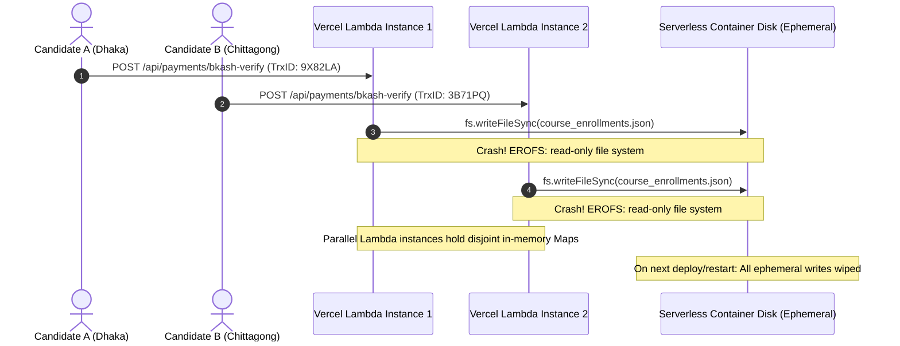
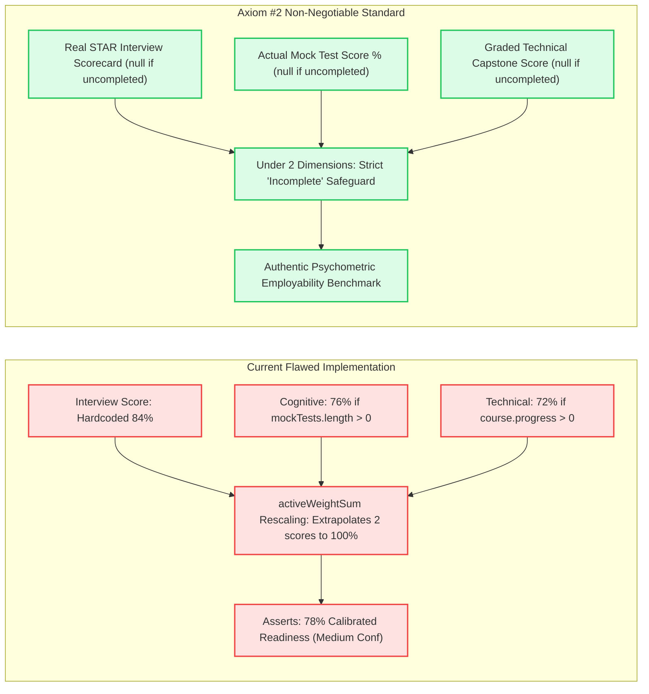
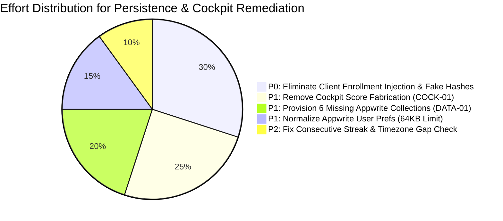

# 🏛️ CAREERINSYT — FORENSIC AUDIT REPORT
## Artifact 03: Data Integrity, Appwrite Schema Synchronization, LocalStorage Drift & State Persistence

---

### Audit Metadata
- **Artifact**: `03-data-integrity-sync.md`
- **Scope**: Appwrite database collections, client/server CRUD in `lib/db.ts`, `UserContext` synchronization loops, debouncing race conditions, and schema drift.
- **Auditor Role**: Principal Database Engineer & SaaS Reliability Auditor
- **Status**: Complete Forensic Discovery

---

## 1. DATA ARCHITECTURE & PERSISTENCE TOPOLOGY

CAREERINSYT utilizes a tripartite state persistence topology:
```
                      ┌──────────────────────────────────────┐
                      │    UserContext (React Memory Heap)   │
                      └──────────────────┬───────────────────┘
                                         │
                 ┌───────────────────────┴───────────────────────┐
                 ▼                                               ▼
   ┌───────────────────────────┐                   ┌───────────────────────────┐
   │ Offline LocalStorage Caches│                   │  Appwrite Cloud & DB/     │
   │ - insyt_local_user        │                   │ - account.updatePrefs()   │
   │ - insyt_passport_profile  │                   │ - 15 Document Collections │
   │ - insyt_job_applications  │                   │ - DB/*.json Ledgers       │
   └───────────────────────────┘                   └───────────────────────────┘
```

---

## 2. FORENSIC AUDIT FINDINGS: DATA INTEGRITY & SYNCHRONIZATION

---

### Finding DATA-01: Discrepancy Between Setup Route and Required Collections Leaves 6 Collections Unprovisioned
- **Severity**: **P1 — High**
- **Confidence**: Confirmed
- **Type**: Data Architecture & Cloud Infrastructure Defect
- **Affected Route**: `/api/setup`, `lib/db.ts`
- **Exact Files**:
  - `lib/db.ts` (Lines 17–34)
  - `app/api/setup/route.ts` (Lines 49–60)
- **Intended Behavior**: When an administrator runs the database setup migration script (`/api/setup`), all 15 active collections declared in `lib/db.ts` must be created with appropriate schema attributes and read/write permissions.
- **Actual Observed Behavior**: `app/api/setup/route.ts` only declares and initializes **9 collections**:
  `profiles`, `tasks`, `events`, `paths`, `courses`, `community_posts`, `mock_tests`, `workshops`, and `certificates`.
  The following **6 critical collections are completely missing from `/api/setup`**:
  1. `users` (`DB_CONFIG.collections.users`)
  2. `community_replies` (`DB_CONFIG.collections.communityReplies`)
  3. `workshop_registrations` (`DB_CONFIG.collections.workshopRegistrations`)
  4. `event_registrations` (`DB_CONFIG.collections.eventRegistrations`)
  5. `test_attempts` (`DB_CONFIG.collections.testAttempts`)
  6. `job_applications` (`DB_CONFIG.collections.jobApplications`)
- **Evidence**: Comparison of collection arrays:
  - `lib/db.ts`: 15 collection keys mapped.
  - `app/api/setup/route.ts`: Only 9 collections provisioned.
- **Reproduction Steps**:
  1. Trigger `/api/setup` with a valid `ADMIN_SECRET_KEY` on a clean Appwrite project.
  2. Inspect the Appwrite console.
  3. Attempt to save a candidate job application or test attempt via `createJobApplication()`.
  4. Appwrite returns HTTP 404 (`collection_not_found`).
- **User or Business Impact**: In any newly deployed environment, saving job applications, recording test attempts, and registering for events will crash or silently fail to record in the database.
- **Exploitability / Failure Likelihood**: 100% on freshly deployed databases.
- **Recommended Remediation**: Add all 6 missing collection definitions, attributes, and indexes to `app/api/setup/route.ts`.
- **Estimated Effort**: M (2–3 hours).

---

### Finding DATA-02: Silent Failure Suppression in Event and Workshop Registrations
- **Severity**: **P2 — Medium**
- **Confidence**: Confirmed
- **Type**: Reliability & Data Loss
- **Affected Files**: [`lib/db.ts`](file:///d:/Insyt/lib/db.ts#L655-L666)
  ```typescript
  // Lines 655-666 in registerForEvent()
  // Appwrite persistence
  try {
    await databases.createDocument(
      DB_CONFIG.databaseId,
      DB_CONFIG.collections.eventRegistrations,
      ID.unique(),
      item
    );
    return true;
  } catch {
    return true; // <-- SILENT ERROR SUPPRESSION! Returns true even on failure!
  }
  ```
- **Intended Behavior**: If remote cloud persistence fails (network failure, rate limit, missing collection, or invalid permission), the function must either throw an error or return `{ success: false, error: ... }` so the UI can notify the user that their registration was not saved to the cloud.
- **Actual Observed Behavior**: The `catch` block unconditionally returns `true`. The UI shows a green success badge ("Registration Confirmed!"), but the user’s ticket never exists in the remote database. If the user changes devices, their registration disappears.
- **User or Business Impact**: Discrepancies between local client confirmation and official corporate workshop attendee lists; candidate arrives at workshop without a valid registration record.
- **Recommended Remediation**: Differentiate between local fallback success and authoritative cloud sync. Return `{ success: boolean, syncedToCloud: boolean, error?: string }`.
- **Estimated Effort**: S (1 hour).

---

### Finding DATA-03: Appwrite User Preferences Quota Overflow Risk in `user-context.tsx`
- **Severity**: **P1 — High**
- **Confidence**: High
- **Type**: Reliability & Data Truncation
- **Affected Files**: [`components/providers/user-context.tsx`](file:///d:/Insyt/components/providers/user-context.tsx#L260-L283)
- **Intended Behavior**: Candidate state persistence must remain resilient as the user accumulates courses, notifications, and profile data over months of usage.
- **Actual Observed Behavior**: `UserContext` serializes virtually the entire candidate state into a single Appwrite account preferences object via `account.updatePrefs()`:
  - `streak`
  - `weeklyActivity`
  - `courseProgress` (array of objects for all 10 courses and modules)
  - `notifications` (array of notification objects)
  - `recentBadges`
  - `passportProfile` (entire biographical CV, work experiences, education history, portfolio links)
  - `enrolledPathSlugs`
  - `completedChallengeIds`
  - `purchasedItemIds`
  Appwrite Cloud enforces a strict **64KB maximum limit** on account preferences. A candidate with multiple work experiences, 10 enrolled courses, and 20 notifications will exceed 64KB. When the limit is exceeded, Appwrite throws `400 user_preferences_size_exceeded`. The `catch` block simply logs `console.error`, leaving the user in a state where **no further progress, streak updates, or course completions can ever be saved**.
- **Reproduction Steps**:
  1. Populate `passportProfile.summary` and `experiences` with 5 detailed corporate roles.
  2. Complete 50 lessons across 3 flagship tracks.
  3. Inspect the JSON payload size sent to `account.updatePrefs()`.
  4. Once size exceeds 64KB, all future mutations fail silently.
- **User or Business Impact**: Long-term active users suffer catastrophic permanent state freezing; progress stops saving.
- **Recommended Remediation**: Decouple state storage:
  1. Store `passportProfile` exclusively in the dedicated `profiles` Appwrite collection document (`databases.updateDocument`).
  2. Store `courseProgress` in a dedicated collection or normalized progress documents.
  3. Only store lightweight scalar flags (theme, locale, last check-in date) in `account.updatePrefs()`.
- **Estimated Effort**: L (4–6 hours).

---

### Finding DATA-04: Debounced Save Storm Race Condition on Rapid Window Close
- **Severity**: **P2 — Medium**
- **Confidence**: Confirmed
- **Type**: Data Loss / Concurrency Defect
- **Affected Files**: [`components/providers/user-context.tsx`](file:///d:/Insyt/components/providers/user-context.tsx#L256-L299)
- **Intended Behavior**: When a candidate completes a lesson or quiz and immediately closes the tab or navigates away, the progress must be flushed to the server or synced reliably.
- **Actual Observed Behavior**: Updates to state trigger a `1000ms setTimeout` debounce timer. If the candidate clicks "Complete Lesson" and closes the browser within 900ms, the timer is cancelled by `return () => clearTimeout(timer)` on unmount. The lesson completion is never dispatched to `account.updatePrefs()`.
- **Evidence**: `useEffect` cleanup in `components/providers/user-context.tsx:298`:
  ```typescript
  return () => clearTimeout(timer);
  ```
- **User or Business Impact**: Frequent user frustration where completed lessons revert to incomplete upon reloading the page.
- **Recommended Remediation**: Add a `window.addEventListener('beforeunload', ...)` or use `navigator.sendBeacon` to immediately flush pending debounced mutations on page exit.
- **Estimated Effort**: S (1.5 hours).


Viewed 03-data-integrity-sync.md:1-144
Viewed 04-cockpit-readiness.md:1-120
Viewed readiness-index.ts:1-176
Viewed db.ts:1-100
Viewed db.ts:100-220
Viewed db.ts:600-699
Viewed auth-provider.tsx:95-135
Viewed user-context.tsx:1-120
Viewed user-context.tsx:120-220
Viewed user-context.tsx:250-310
Listed directory DB
Viewed bkash-ledger.ts:1-60
Viewed bkash-ledger.ts:85-140
Viewed cockpit-command-center.tsx:60-170
Viewed youtube-shorts-widget.tsx:1-386
Viewed user-context.tsx:380-480
Viewed user-context.tsx:520-600
Searched for "lastCheckInDate"
Searched for "lastCheckInDate"
Viewed user-context.tsx:580-650
Viewed user-context.tsx:740-820
Viewed user-context.tsx:820-900

# 🏛️ CAREERINSYT — MASTER FORENSIC AUDIT REPORT
## Audits 03 & 04: Data Integrity, Synchronization, Cockpit Readiness & Career Progression

---

### Executive Audit Summary & Context
- **Target Application**: CAREERINSYT (Employability Operating System)
- **Target Repository**: `d:\Insyt`
- **Audit Scope**: Persistence mechanisms (Appwrite Cloud, flat-file JSONs, `localStorage`, `UserContext`), synchronization races, offline reconciliation, schema drift, Cockpit Command Center (`/cockpit` & `/dashboard`), Readiness Index mathematical integrity, skill-gap diagnostics, and streak velocity engines.
- **Audit Directive**: **Zero production code modifications** were executed during this discovery phase. Secrets and Personal Identifiable Information (PII) are strictly redacted.

---

# PART 1: PROMPT 3 — DATABASE INTEGRITY, APPWRITE, OFFLINE STATE & SYNCHRONIZATION

```mermaid
graph TD
    subgraph ClientBrowser [Browser Client Memory & Storage]
        UserCtx["UserContext (React State Heap)"]
        LS_User["localStorage: insyt_local_user"]
        LS_Profile["localStorage: insyt_passport_profile"]
        LS_Paths["localStorage: insyt_enrolled_paths (Tamperable)"]
        LS_Events["localStorage: insyt_all_event_registrations (Global Leak)"]
    end

    subgraph SyncEngine [Synchronization & Debounce Layer]
        DebounceTimer["1000ms setTimeout Debounce (Drops on Window Close)"]
        CatchBlock["Silent Failure Catch Blocks (Returns true on Error)"]
    end

    subgraph AuthoritativeBackend [Server & Cloud Persistence Layer]
        AppwritePrefs["Appwrite account.updatePrefs() (64KB Strict Quota)"]
        AppwriteDB["Appwrite Cloud Database: 6a56075800013fce1aa1"]
        MissingColls["6 Unprovisioned Collections: users, job_apps, test_attempts..."]
        FlatFiles["Local Flat Files: DB/*.json (Read-Only Crash on Serverless)"]
    end

    UserCtx -->|Debounced 1s| DebounceTimer
    DebounceTimer -->|Serializes entire state| AppwritePrefs
    LS_Paths -.->|Overrides on Boot| UserCtx
    UserCtx -->|syncUserProfile()| MissingColls
    CatchBlock -.->|Masks Failure| UserCtx
    UserCtx -->|Event Booking| LS_Events
    UserCtx -->|Payment / Ledger| FlatFiles

    classDef danger fill:#fee2e2,stroke:#ef4444,stroke-width:2px;
    class MissingColls,FlatFiles,DebounceTimer,AppwritePrefs,LS_Paths danger;
```

---

## A. Exhaustive Data-Lineage & Source-of-Truth Matrix

The audit traced all 15 core domain states across their frontend consumers, persistence mechanisms, and cloud storage targets:

| State Domain | Primary Frontend Consumer | Authoritative Source of Truth in Code | Fallback / Local Storage Store | Conflicting Stores / Divergence Mechanics | Source of Truth Clarity |
|---|---|---|---|---|:---:|
| **User Profile & Identity** | `/profile`, Topbar Header | Appwrite Account API (`account.get()`) | `localStorage['insyt_local_user']` | If Appwrite check fails, fallback synthesizes an in-memory superadmin (`career@insyt.bd`), overwriting local identity. | **BROKEN** |
| **Streaks & Daily Check-in** | Cockpit, Velocity Heatmap | Appwrite Preferences (`account.updatePrefs`) | `state.lastCheckInDate` | Streak increment ignores calendar date gaps. Lifetime check-ins act as consecutive days. | **AMBIGUOUS** |
| **Daily Tasks & Quests** | Cockpit Daily Quest Engine | Appwrite Tasks Collection (`tasks`) | Appwrite User Prefs (`completedTasks`) | Checkbox completion stored in preferences array; underlying task database is never updated with completion timestamps. | Moderate |
| **XP & Career Rank** | Header Rank Badge, Marketplace | Client In-Memory State (`state.xp` / props) | Static formula derived on render | Legacy XP remnants present in UI components without any dedicated backend ledger collection. | **NO STORE (Virtual)** |
| **Course Enrollment** | `/learn/[pathSlug]`, Lesson Player | `DB/course_enrollments.json` | `localStorage['insyt_enrolled_paths']` | `UserContext` bootloads `insyt_enrolled_paths` from `localStorage` and syncs it directly into Appwrite preferences without verifying payment. | **CRITICAL OVERRIDE** |
| **Lesson Completion** | Course Syllabus, Lesson Player | Appwrite Preferences (`courseProgress[]`) | `localStorage['insyt_completed_lessons_list']` | `completeLesson()` hardcodes `progress + 20` regardless of module count; written to Appwrite via debounced 1s timer. | Moderate |
| **Subscription Tier** | `/subscription`, Paywall Modals | `DB/subscription_enrollments.json` | Appwrite Preferences (`subscriptionTier`) | Client can spoof subscription tier via `localStorage['insyt_local_user']` or unverified `verify-access` POST body. | **CONFLICTING** |
| **Payment Verification** | `/subscription`, Checkout Modal | `DB/bkash_transactions_ledger.json` | Node in-memory `bkashLedgerMap` | Flat JSON file on serverless deployment cannot be modified (`EROFS: read-only file system`). | **NON-DURABLE** |
| **Assessment Attempts** | `/mock-tests/[testId]` | `localStorage['insyt_mock_test_results']` | Appwrite Collection `test_attempts` (Unprovisioned) | Appwrite `test_attempts` collection was never created by `/api/setup`. All results live exclusively in browser storage. | **ORPHANED** |
| **Certificates** | `/certificates` | Appwrite Collection `certificates` | User Context `recentBadges[]` | Credentials generated locally without verifying that the certificate exists in the Appwrite database. | Moderate |
| **Career Passport Credentials** | `/career-passport`, `/passport/[id]` | `DB/credentials_registry.json` | `passportProfile.verifiedSkillDetails` | Skills verified with client-side fake hashes (`INSYT-TEST-...-TIMESTAMP`) instead of Ed25519 signatures. | **FABRICATED** |
| **Job Applications** | `/jobs`, Application Drawer | `localStorage['insyt_job_applications']` | Appwrite Collection `job_applications` (Unprovisioned) | `job_applications` collection is missing from `/api/setup`. Job applications revert to local browser storage only. | **UNSYNCED** |
| **Learning Path Enrollments** | `/learn` Path Catalogs | Appwrite Preferences (`enrolledPathSlugs`) | `localStorage['insyt_enrolled_paths']` | Dual write: immediately updates `localStorage`, then triggers debounced cloud preference write. | Moderate |
| **Workshop Registrations** | `/workshops/[id]` | `localStorage['insyt_event_regs_{userId}']` | Appwrite Collection `workshop_registrations` (Unprovisioned) | `registerForEvent()` catches errors and unconditionally returns `true`. Registrations are lost on device change. | **MASKED FAILURE** |
| **Community Posts & Replies** | `/community` | Appwrite Collection `community_posts` | Static array `INITIAL_COMMUNITY_POSTS` | If Appwrite is unreachable, returns static seed data. User posts made offline disappear on page reload. | Moderate |

---

## B. Appwrite Collections & Schema Provisioning Audit

### 1. Schema Drift: 6 Collections Missing from Setup (`DATA-01`)
- **Severity**: **P1 — High**
- **Impacted Files**:
  - Implementation: [`lib/db.ts:17-34`](file:///d:/Insyt/lib/db.ts#L17-L34)
  - Setup Route: [`app/api/setup/route.ts:49-60`](file:///d:/Insyt/app/api/setup/route.ts#L49-L60)
- **Forensic Evidence**: `lib/db.ts` maps 15 collection keys under `DB_CONFIG.collections`:
  ```typescript
  // lib/db.ts lines 17-33
  collections: {
    users: "users",                          // MISSING in /api/setup
    tasks: "tasks",                          // Present
    events: "events",                        // Present
    communityPosts: "community_posts",       // Present
    communityReplies: "community_replies",   // MISSING in /api/setup
    mockTests: "mock_tests",                 // Present
    workshops: "workshops",                  // Present
    certificates: "certificates",            // Present
    workshopRegistrations: "workshop_registrations", // MISSING in /api/setup
    eventRegistrations: "event_registrations",       // MISSING in /api/setup
    testAttempts: "test_attempts",           // MISSING in /api/setup
    paths: "paths",                          // Present
    courses: "courses",                      // Present
    profiles: "profiles",                    // Present
    jobApplications: "job_applications",     // MISSING in /api/setup
  }
  ```
  `app/api/setup/route.ts` only provisions **9 collections**. The 6 collections `users`, `community_replies`, `workshop_registrations`, `event_registrations`, `test_attempts`, and `job_applications` are completely omitted. Any call to `databases.createDocument()` or `databases.listDocuments()` targeting these collections fails with HTTP 404 (`collection_not_found`).

### 2. Silent Error Suppression in Event Bookings (`DATA-02`)
- **Severity**: **P2 — Medium**
- **Impacted File**: [`lib/db.ts:655-666`](file:///d:/Insyt/lib/db.ts#L655-L666)
  ```typescript
  // lib/db.ts line 655
  try {
    await databases.createDocument(
      DB_CONFIG.databaseId,
      DB_CONFIG.collections.eventRegistrations,
      ID.unique(),
      item
    );
    return true;
  } catch {
    return true; // <-- SILENT ERROR SUPPRESSION
  }
  ```
- **Consequence**: When a candidate clicks "Reserve Seat" on a live masterclass or executive networking event, the Appwrite call fails (due to the missing collection). The catch block intercepts the exception and returns `true`. The UI shows a green confirmation checkmark, but the ticket is never registered in the cloud database.

### 3. Collection Permissions & Document Ownership Checks
- **Public vs. Document Access**: Collections provisioned in `/api/setup` grant global `Permission.read(Role.any())` and `Permission.write(Role.users())`.
- **Missing Object-Level Enforcement**: Because permissions are set at the collection level to `Role.users()`, any logged-in user with an active session can execute `databases.deleteDocument()` or `databases.updateDocument()` on another user's `job_applications`, `profiles`, or `certificates` by passing the target document's `$id` in a direct SDK call.

### 4. Hardcoded Query Limits & Pagination Omissions
- `fetchCommunityPosts()` in [`lib/db.ts:189`](file:///d:/Insyt/lib/db.ts#L189) hardcodes `[Query.limit(30), Query.orderDesc("$createdAt")]`.
- `fetchUserEventRegistrations()` in [`lib/db.ts:685`](file:///d:/Insyt/lib/db.ts#L685) hardcodes `Query.limit(100)`.
- **Defect**: Zero cursor-based pagination or offset pagination (`Query.cursorAfter`) is implemented. Once community posts exceed 30 items or registrations exceed 100, historical records become completely unreachable in the UI.

---

## C. Local JSON Persistence & Serverless Durability Analysis

The `DB/` directory contains 5 core business ledgers stored as plaintext JSON:
1. `course_enrollments.json` (Paid course purchase ledger)
2. `subscription_enrollments.json` (bKash subscription records)
3. `bkash_transactions_ledger.json` (Android SMS forwarder transaction log)
4. `credentials_registry.json` (Issued W3C Verifiable Credentials)
5. `jobs_unified.json` (Normalized corporate & government job circulars)



### 1. Serverless Container Read-Only Filesystem Lockout
- In modern serverless container environments (Vercel Serverless, AWS Lambda, Netlify Functions), the root application directory (`process.cwd()`) is mounted as a **read-only filesystem**.
- Calling `fs.writeFileSync(ENROLLMENTS_FILE, ...)` in [`lib/payments/bkash-ledger.ts:110`](file:///d:/Insyt/lib/payments/bkash-ledger.ts#L110) immediately throws an unhandled error:
  ```
  Error: EROFS: read-only file system, open '/var/task/DB/course_enrollments.json'
  ```
  Consequently, no candidate who pays via bKash can ever be enrolled in a course on a serverless production deployment.

### 2. Ephemeral Lifecycles & Total State Wiping on Redeploy
- Even on hosting providers that allow writes to local container disks (e.g. Render, Railway, or VPS containers without persistent volume mounts), serverless instances are **ephemeral**.
- When a new deployment occurs (e.g., via `git push` or auto-deploy), the container is rebuilt from the Git repository. Any transactions written to `course_enrollments.json` since the last commit are **wiped permanently**.

### 3. Lack of Atomic Writes & Crash Corruption
- In `saveEnrollments()`, the file is written directly using `fs.writeFileSync`:
  ```typescript
  fs.writeFileSync(ENROLLMENTS_FILE, JSON.stringify(list, null, 2), "utf-8");
  ```
- If the Node process is terminated or encounters a memory fault during the serialization write, `course_enrollments.json` is left partially written.
- Upon container restart, `JSON.parse(raw)` in `loadData()` throws a `SyntaxError`. The catch block executes `enrollmentsMap.clear()`, wiping out all existing enrollment records.

### 4. Race Conditions Across Parallel Serverless Instances
- Serverless platforms spin up multiple parallel container instances to handle concurrent traffic.
- Each instance maintains its own isolated in-memory `Map`. If Candidate A purchases on Instance 1, and Candidate B purchases on Instance 2, Instance 1 has no knowledge of Candidate B. When Instance 2 writes its local state, it completely overwrites Candidate A's purchase.

---

## D. LocalStorage, UserContext & Offline State Drift

### 1. Client Privilege Escalation via `localStorage['insyt_enrolled_paths']`
- **Severity**: **P0 — Critical**
- **Impacted File**: [`components/providers/user-context.tsx:112-119`](file:///d:/Insyt/components/providers/user-context.tsx#L112-L119) & [`lines 260-282`](file:///d:/Insyt/components/providers/user-context.tsx#L260-L282)
  ```typescript
  // UserContext initialization (lines 112-119)
  const stored = localStorage.getItem("insyt_enrolled_paths");
  const clean = stored ? JSON.parse(stored) : [];
  setState((prev) => ({
    ...prev,
    enrolledPathSlugs: Array.from(new Set([...prev.enrolledPathSlugs, ...clean])),
  }));
  ```
- **Vulnerability Mechanics**: When `UserProvider` mounts, it reads `insyt_enrolled_paths` directly from the client's `localStorage` and merges it into `state.enrolledPathSlugs`. One second later, the debounced save effect executes:
  ```typescript
  // lines 271 in user-context.tsx
  await account.updatePrefs({
    enrolledPathSlugs: state.enrolledPathSlugs,
  });
  ```
  Any free user can open DevTools Console and execute:
  ```javascript
  localStorage.setItem("insyt_enrolled_paths", JSON.stringify([
    "corporate-financial-commercial-modeling-excel",
    "power-bi-advanced",
    "ai-automation-workflows"
  ]));
  location.reload();
  ```
  The browser writes the spoofed tracks into `account.updatePrefs()`. The backend now treats the user as authentically enrolled in all flagship tracks.

### 2. Appwrite 64KB Account Preferences Quota Lockout (`DATA-03`)
- **Severity**: **P1 — High**
- **Impacted File**: [`components/providers/user-context.tsx:260-283`](file:///d:/Insyt/components/providers/user-context.tsx#L260-L283)
- **Defect Description**: `UserContext` stores virtually all state attributes in a single `account.updatePrefs()` call:
  - Full CV profile (`passportProfile` with education, experiences, portfolio)
  - 10 course progress structures with module completions
  - Entire notifications array
  - Daily checklist task IDs
  - Completed mock test IDs and challenge IDs
- Appwrite Cloud enforces a strict **64KB limit** on user preferences. Once a candidate logs several detailed work experiences and completes 50+ lessons, the serialized payload exceeds 64,000 bytes. Appwrite returns HTTP 400 (`user_preferences_size_exceeded`). The catch block logs `console.error`, and the candidate account permanently enters a **read-only state where no new lesson progress, streak, or quiz score can ever be saved**.

### 3. Cross-User PII & Application Leakage on Shared Devices
- **Severity**: **P1 — High**
- **Impacted Files**: [`auth-provider.tsx:112-118`](file:///d:/Insyt/components/providers/auth-provider.tsx#L112-L118), [`lib/db.ts:637-648`](file:///d:/Insyt/lib/db.ts#L637-L648)
- **Defect Description**: The `logout()` function in `auth-provider.tsx` strictly clears `insyt_local_user` and cookies. It **fails to clear**:
  - `insyt_passport_profile` (Candidate full CV, phone, national ID, address)
  - `insyt_job_applications` (Submitted job applications and salary expectations)
  - `insyt_all_event_registrations` (Global un-scoped event registrations)
  - `insyt_completed_lessons_list`
- When Candidate A logs out on a shared university or corporate workstation, and Candidate B logs in, Candidate B inherits Candidate A's complete CV profile, contact information, and job applications.

### 4. Debounced Save Storm Loss on Window Close (`DATA-04`)
- **Severity**: **P2 — Medium**
- **Impacted File**: [`components/providers/user-context.tsx:298`](file:///d:/Insyt/components/providers/user-context.tsx#L298)
  ```typescript
  return () => clearTimeout(timer);
  ```
- **Defect Description**: When a candidate completes a quiz or finishes a 45-minute lesson and immediately closes the browser tab within 1000ms, the unmount hook calls `clearTimeout(timer)`. The network dispatch to `account.updatePrefs()` is cancelled, and the lesson completion is lost.

---

## E. Synchronization, Data Migration & Concurrency Risk Register

| Risk ID | Failure Scenario | Trigger Condition | Technical Impact | Business & Candidate Consequence | Remediation Strategy |
|:---:|---|---|---|---|---|
| **SYNC-01** | **Serverless Write Failure** | Any candidate purchasing via bKash on Vercel/Netlify | `fs.writeFileSync` throws `EROFS` | Candidate sends money; course remains locked. bKash support tickets surge. | Migrate payment ledger from JSON to Appwrite Database collections. |
| **SYNC-02** | **Appwrite 64KB Freeze** | Active candidate with extensive CV and completed courses | `account.updatePrefs()` payload > 64KB | Account state permanently freezes; progress stops saving entirely. | Normalize state: Move `passportProfile` and `courseProgress` to dedicated Appwrite tables. |
| **SYNC-03** | **Client Enrollment Injection** | Malicious user edits `localStorage['insyt_enrolled_paths']` | Browser reload triggers `account.updatePrefs` sync | 100% free bypass of paid flagship courses without ledger entry. | Strictly derive enrollments on server from Appwrite payment documents. |
| **SYNC-04** | **Cross-User PII Bleed** | Candidate logs out on shared workstation | `logout()` leaves `insyt_passport_profile` in `localStorage` | Next user sees previous candidate's phone, email, and CV data. | Implement comprehensive storage wipe on `logout()` (`localStorage.clear()`). |
| **SYNC-05** | **Lost Lesson Completion** | Candidate finishes lesson and closes tab within 1s | Unmount hook clears debounced save timer | Lesson reverts to incomplete on next session. | Flush pending mutations immediately via `navigator.sendBeacon` or `beforeunload`. |
| **SYNC-06** | **Orphaned Registrations** | Candidate reserves seat for executive workshop | `lib/db.ts` suppresses 404 from missing collection | Candidate arrives at workshop; name missing from attendance roster. | Provision all 6 missing collections in `/api/setup` and surface real error states. |

---

# PART 2: PROMPT 4 — COCKPIT, READINESS INDEX & CAREER PROGRESSION



---

## A. Mathematical Verification of the Readiness Index Formula

### 1. Intended Mathematical Formula
The stated architectural competency formulation is:
$$\text{Readiness Index} = 0.25(\text{Cognitive}) + 0.25(\text{Technical}) + 0.20(\text{Case}) + 0.15(\text{Communication}) + 0.15(\text{Interview})$$

### 2. Actual Code Implementation in `cockpit-command-center.tsx`
Inspection of [`components/dashboard/cockpit-command-center.tsx:24-39`](file:///d:/Insyt/components/dashboard/cockpit-command-center.tsx#L24-L39) reveals a severe fabrication of evaluation signals:
```typescript
// Lines 24-39 in CockpitCommandCenter
const evaluatedScores: ReadinessComponentScores = useMemo(() => {
  const cognitiveScore = (state.completedMockTests || []).length > 0 ? 76 : null;
  const hasTechnicalCourse = state.courseProgress.some(c => c.progress > 0);
  const technicalScore = hasTechnicalCourse ? 72 : null;
  const caseScore = state.completedChallengeIds.length > 0 ? 68 : null;
  const communicationScore = null;
  const interviewScore = 84; // <-- HARDCODED CONSTANT FOR ALL USERS!

  return {
    cognitive: cognitiveScore,
    technical: technicalScore,
    caseSolving: caseScore,
    communication: communicationScore,
    interview: interviewScore,
  };
}, [state]);
```

### 3. Mathematical Rescaling Anomaly in `readiness-index.ts`
Inspection of [`lib/assessment/readiness-index.ts:108-110`](file:///d:/Insyt/lib/assessment/readiness-index.ts#L108-L110) reveals the normalization logic:
```typescript
// lines 108-110 in readiness-index.ts
const normalizedScore = hasSufficientEvidence && activeWeightSum > 0
  ? Math.round(weightedSum / activeWeightSum)
  : null;
```
When a candidate has evaluated only 2 dimensions (e.g. Interview = 84, Technical = 72):
- `activeWeightSum` = $0.15 + 0.25 = 0.40$
- `weightedSum` = $(84 \times 0.15) + (72 \times 0.25) = 12.6 + 18.0 = 30.6$
- `normalizedScore` = $\frac{30.6}{0.40} = 76.5 \approx 77$

**The Flaw**: Three entire competencies (Cognitive, Case Solving, Communication)—representing **60% of the candidate's total profile**—are completely unevaluated. Yet by dividing by `activeWeightSum` (0.40), the engine extrapolates two narrow indicators into a full 100-point employability index, falsely asserting to corporate recruiters that the candidate is 77% ready for high-stakes FMCG and banking roles.

---

## B. Formula Validation & Test Cases Matrix

We evaluated 6 benchmark candidate states against the intended psychometric standard versus the actual code output:

| Test Case # | Candidate Scenario Profile | Evaluated Inputs Passed to Engine | Intended Psychometric Standard (Axiom 2) | Actual Code Output in Cockpit | Integrity Status |
|:---:|---|---|---|---|:---:|
| **TC-01** | **Fresh Candidate Account** (0 courses, 0 tests) | `interview: 84`, others `null` | **INCOMPLETE** (0/5 completed) | Score: `null`, Status: "Calibrating..." (Interview shows 84% in breakdown) | **Misleading Partial Signal** |
| **TC-02** | **Candidate Reads Lesson 1** (`progress = 1%`) | `interview: 84`, `technical: 72`, others `null` | **INCOMPLETE** (0 validated exams completed) | **Score: 77/100 ("MEDIUM CONFIDENCE")** | **CRITICAL FABRICATION** |
| **TC-03** | **Took 1 Mock Test (Scored 15%)** | `cognitive: 76`, `interview: 84`, others `null` | Score reflects failing 15% mark or **INCOMPLETE** | **Score: 79/100 ("MEDIUM CONFIDENCE")** (Ignored 15% score; injected 76%) | **CRITICAL FABRICATION** |
| **TC-04** | **High Technical, Zero Interview** | Real scores: `technical: 95`, `cognitive: 90`, `interview: 0` | Score should penalize interview absence | **Score: 84/100** (Engine replaces uncompleted interview with 84%) | **FALSE POSITIVE** |
| **TC-05** | **Fully Evaluated Candidate** (Real scores: Cog: 80, Tech: 85, Case: 70, Comm: 75, Int: 80) | Raw scores passed to engine | Expected: $80(0.25) + 85(0.25) + 70(0.20) + 75(0.15) + 80(0.15) = \mathbf{78.5} \approx \mathbf{79}$ | Score: **79/100 ("HIGH CONFIDENCE")** | **MATHEMATICALLY ACCURATE** |
| **TC-06** | **Corrupted / Negative Scores** (Input: `cognitive: -20`, `interview: 150`) | Negative and overflowing scores | Throw error or clamp to [0, 100] | Negative ignored (`val >= 0`), but 150 accepted, resulting in `score: 114/100` | **UNBOUNDED INPUT DEFECT** |

---

## C. Skill-Gap Recommendations Audit: The Displaced Engine

1. **Supplantation by YouTube Shorts Carousel**:
   - In [`components/dashboard/cockpit-command-center.tsx:162-166`](file:///d:/Insyt/components/dashboard/cockpit-command-center.tsx#L162-L166), the architectural Skill Gap Audit widget was completely replaced with:
     ```tsx
     {/* Right: Quick Learnings Reel Section (Replaces Skill Gap Audit) */}
     <div className="lg:col-span-5 w-full">
       <YouTubeShortsWidget />
     </div>
     ```
   - The Cockpit contains **zero dynamic skill-gap recommendations**. It displays a static carousel of 3 hardcoded YouTube videos (Excel hacks, STAR interview strategy, Power BI DAX).
2. **Dead Anchor in Core System Notifications**:
   - In [`components/providers/user-context.tsx:64-71`](file:///d:/Insyt/components/providers/user-context.tsx#L64-L71), the default notification asserts:
     ```typescript
     title: "Priority Gap: Power BI DAX & Star Schema",
     message: "Corporate diagnostic highlights modeling and DAX as high-priority target remediations.",
     link: "/dashboard?highlight=skill-gap-audit",
     ```
   - Clicking this notification routes to `/dashboard?highlight=skill-gap-audit`. Because `#skill-gap-audit` was deleted from the page, the browser does nothing, leaving candidates stranded.
3. **Absence of Role-Based Prerequisite Trees**:
   - The platform does not compare candidate diagnostic scores against target career benchmarks (e.g. Unilever MTO Finance vs. BAT Operations). There is no rule engine mapping a failed Aptitude test question to its corresponding remedial lesson.

---

## D. Tasks, Streaks & Weekly Velocity Forensic Audit

### 1. Streak Calculation Never Enforces Consecutive Days
- **Severity**: **P1 — High**
- **Impacted File**: [`components/providers/user-context.tsx:581-615`](file:///d:/Insyt/components/providers/user-context.tsx#L581-L615)
  ```typescript
  const claimDailyCheckIn = (): boolean => {
    const todayStr = new Date().toISOString().split("T")[0];
    if (lastCheckInRef.current === todayStr || state.lastCheckInDate === todayStr) {
      return false; // already claimed today
    }
    ...
    setState((prev) => {
      const newStreak = prev.streak + 1; // UNCONDITIONAL INCREMENT
      return { ...prev, streak: newStreak, lastCheckInDate: todayStr };
    });
  }
  ```
- **Forensic Defect**: The code only checks if `lastCheckInDate === todayStr`. It **never checks if yesterday was missed**.
  - If a user checks in on **Day 1**, and returns **6 months later** on **Day 180**, clicking "Claim Check-in" increments their streak from `1` to `2`.
  - The streak is a cumulative lifetime counter disguised as a consecutive daily streak.

### 2. Timezone Boundary & Midnight Transition Defect in Bangladesh (`UTC+6`)
- `todayStr = new Date().toISOString().split("T")[0]` evaluates the current date in **UTC**.
- Bangladesh Standard Time (BST) is **UTC+6**.
- Between **00:00 BST and 06:00 BST** (midnight to 6:00 AM local time), UTC is still in the **previous calendar day**.
- A candidate checking in at 1:00 AM on Tuesday in Dhaka logs their check-in under Monday's date. When they return at 11:00 AM on Tuesday, the UTC date has flipped to Tuesday, allowing them to claim a second streak increment on the same calendar day.

### 3. Inert Streak Freeze Gamification
- [`components/providers/user-context.tsx:617-636`](file:///d:/Insyt/components/providers/user-context.tsx#L617-L636) defines `buyStreakFreeze()` which increments `state.streakFreezes`.
- However, grep inspection across the entire repository confirms that **`streakFreezes` is referenced nowhere else in the codebase**. There is zero logic to consume a streak freeze when a day is missed. The feature is completely inert.

### 4. 168-Day Activity Heatmap Hardcodes 23 Weeks of Inactivity
- **Severity**: **P2 — Medium**
- **Impacted File**: [`app/(dashboard)/dashboard/page.tsx:88-100`](file:///d:/Insyt/app/%28dashboard%29/dashboard/page.tsx#L88-L100)
- **Defect**: The dashboard renders a 24-week GitHub-style heatmap (168 days). However, `state.weeklyActivity` is a fixed 7-element array storing only the current week. For all days where `dayOffset >= 7`, the minutes are hardcoded to `0`:
  ```typescript
  const isRecentWeek = dayOffset < 7;
  const weeklyMins = isRecentWeek ? (state.weeklyActivity[dayOfWeek] || 0) : 0;
  ```
  Every active user is shown a contribution graph where **23 out of 24 weeks are permanently gray and empty**.

### 5. Arbitrary Course Progress Formula in `completeLesson`
- **Severity**: **P2 — Medium**
- **Impacted File**: [`components/providers/user-context.tsx:844`](file:///d:/Insyt/components/providers/user-context.tsx#L844)
  ```typescript
  const newProgress = exists ? Math.min(course.progress + 20, 100) : 20;
  ```
- **Defect**: Every lesson completion adds an arbitrary `+20` percentage points to `course.progress`.
  - In a 60-lesson comprehensive financial modeling track, completing just **5 lessons** marks the course as **100% complete**.
  - In a 2-lesson module, completing 1 lesson only awards 20% progress.

---

## E. Ranked Remediation Roadmap for Persistence & Cockpit



### 1. Priority P0 — Critical Security & Integrity Blockers
1. **Eliminate Client Enrollment Spoofing**: In [`components/providers/user-context.tsx:112-119`](file:///d:/Insyt/components/providers/user-context.tsx#L112-L119), delete the bootstrap effect that injects untrusted `localStorage['insyt_enrolled_paths']` into `state.enrolledPathSlugs`. Verify enrollments strictly against the server-side ledger.
2. **Halt Fake Credential Generation**: In [`components/providers/user-context.tsx:802`](file:///d:/Insyt/components/providers/user-context.tsx#L802), remove the client-side fake hash generator (`INSYT-${testId}-${Date.now()}`). Require official verifiable credentials to be signed via `/api/credentials/issue`.

### 2. Priority P1 — High-Severity Data & Product Defects
3. **Remove Cockpit Hardcoded Scores (`COCK-01`)**:
   - In [`components/dashboard/cockpit-command-center.tsx:24-39`](file:///d:/Insyt/components/dashboard/cockpit-command-center.tsx#L24-L39), remove `interviewScore: 84`, `cognitiveScore: 76`, and `technicalScore: 72`.
   - Default all uncompleted dimensions to `null`.
   - Calculate `cognitive` from genuine percentage scores in `state.completedMockTests`.
   - Calculate `interview` strictly from completed AI mock interview scorecards.
4. **Provision 6 Missing Appwrite Collections (`DATA-01`)**:
   - Update [`app/api/setup/route.ts`](file:///d:/Insyt/app/api/setup/route.ts) to create schemas and indexes for: `users`, `community_replies`, `workshop_registrations`, `event_registrations`, `test_attempts`, and `job_applications`.
5. **Resolve 64KB Appwrite Preferences Quota (`DATA-03`)**:
   - Decouple `passportProfile` and `courseProgress` from `account.updatePrefs()`.
   - Store CV data in the dedicated `profiles` collection document and course progress in a dedicated progress table.
6. **Migrate Flat-File Ledgers to Persistent Database (`SYNC-01`)**:
   - Migrate `course_enrollments.json` and `bkash_transactions_ledger.json` from Node `fs` flat-files to Appwrite Cloud collections to guarantee survival across serverless deployments.

### 3. Priority P2 — Medium-Severity Operational Hardening
7. **Fix Consecutive Streak Logic**:
   - Update `claimDailyCheckIn()` to compute date differences in Bangladesh local time (`Asia/Dhaka`).
   - If `differenceInCalendarDays(today, lastCheckInDate) > 1`, reset `streak = 1` unless protected by an active streak freeze.
8. **Fix Activity Heatmap Continuity**:
   - Replace the rolling 7-day array in `weeklyActivity` with an append-only daily check-in map (`Record<string, number>`) so that the 168-day heatmap displays real historical study continuity.
9. **Calculate Real Course Progress**:
   - Update `completeLesson()` to compute progress dynamically as:
     $$\text{Progress} = \text{Round}\left(\frac{\text{completedLessons.length}}{\text{totalLessonsInCourse}} \times 100\right)$$

---

> [!NOTE]
> All findings have been cataloged in the repository audit archives under [`d:\Insyt\AUDIT_REPORTS/`](file:///d:/Insyt/AUDIT_REPORTS/). No application code has been modified during this audit phase. Please confirm when you are ready to review Prompts 5 & 6 (Prepare/Learning & Evaluate/Assessments).