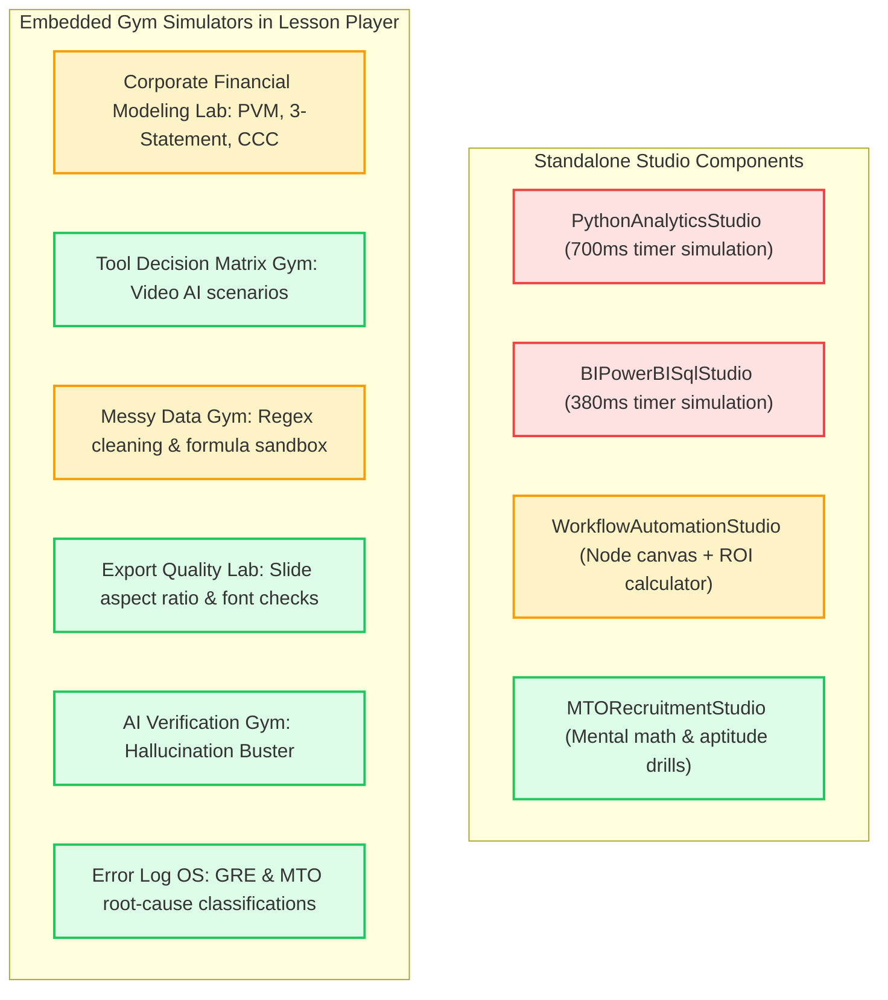

# 🏛️ CAREERINSYT — FORENSIC AUDIT REPORT
## Artifact 05: Prepare Pillar, Applied Curriculum, Interactive Studios, Financial Modeling & Sandbox Execution

---

### Audit Metadata
- **Artifact**: `05-prepare-learning.md`
- **Scope**: Flagship Academies (Excel CCFCM, Python CCDAS, Power BI CEBI, Workflow Automation CEAS, AI Workplace, CapCut Video AI), 10 Learning Paths, 10 Courses, 248 authored lessons, Lesson Player (`app/(dashboard)/learn/[pathSlug]/[courseSlug]/[lessonSlug]/page.tsx`), 4 Standalone Practice Studios, 6 Inline Gym Simulators, Financial Modeling Workbook Validation, and Content Delivery Networks.
- **Auditor Role**: Principal Educational Technology Architect & Full-Stack Sandbox Auditor
- **Status**: Complete Forensic Discovery (Prompt 5 Fulfillment)

---

## 1. EXECUTIVE CURRICULUM & COURSE CENSUS

The audit performed an exhaustive static analysis of the repository curriculum files (`lib/data/courses.ts`, `lib/data/lessons.ts`, and 7 specialized lesson databases):

```
D:\Insyt\lib\data\
├── courses.ts                         # 10 Learning Paths, 10 Course Specifications
├── corporate-modeling-lessons.ts       # 60 Corporate Financial Modeling Lessons
├── enterprise-python-lessons.ts        # 40 Enterprise Python & Automation Lessons
├── enterprise-bi-lessons.ts            # 48 Power BI & ANSI SQL Lessons
├── enterprise-automation-lessons.ts    # 40 n8n & Power Automate Lessons
├── corporate-workplace-lessons.ts      # 32 AI-Powered Workplace Lessons
├── capcut-lessons-adapter.ts           # 36 Video Editing & AI Production Lessons
├── mto-mastery-lessons.ts              # 6 Management Trainee Diagnostic Lessons
├── lessons.ts                          # 22 Legacy Compatibility Lessons
└── public/downloads/                   # 3 Physical Downloadable Files
```

### Course & Path Catalog Census Table

| # | Course Title | Path Slug | Course Slug | Authored Lessons | Real Video Source | Quizzes | Downloadable Workbooks Promised in Notes | Physical Download Files on Disk | Studio / Simulator Assigned |
|:---:|---|---|---|:---:|---|:---:|---|---|---|
| **1** | **Corporate Financial & Commercial Modeling in Excel** | `corporate-analyst` | `corporate-financial-commercial-modeling-excel` | **60** | 100% `mov_bbb.mp4` (Big Buck Bunny) | 60 (Leaked) | `M01_L1_RawNavigation_Exercise.xlsx`, `M01_L2_DynamicLookups_Master.xlsx` ... (60 files) | Only 1: `insyt-financial-commercial-master-model.xlsx` (12 KB) | Corporate Financial Modeling Lab (PVM, 3-Statement, CCC) |
| **2** | **Enterprise Python for Corporate Analytics & Process Automation** | `corporate-analyst` | `enterprise-python-corporate-analytics-process-automation` | **40** | 100% `mov_bbb.mp4` | 40 (Leaked) | `py_starter_batch.py`, `orders_erp.parquet` ... | None | `PythonAnalyticsStudio` (Simulated 700ms timer) |
| **3** | **Enterprise Business Intelligence: Power BI & SQL for Corporate Analysts** | `corporate-analyst` | `enterprise-business-intelligence-power-bi-sql-corporate-analysts` | **48** | 100% `mov_bbb.mp4` | 48 (Leaked) | `insyt_commercial_cube.pbix`, `vw_sales_cube.sql` | `insyt-bi-capstone-starter.sql`, `insyt-bi-capstone-brief.md` | `BIPowerBISqlStudio` (Simulated 380ms timer) |
| **4** | **Applied Workplace AI: Enterprise Workflow Automation with n8n & Power Automate** | `applied-ai-automation` | `applied-workplace-ai-enterprise-workflow-automation` | **40** | 100% `mov_bbb.mp4` | 40 (Leaked) | `n8n_invoice_reconciliation.json`, `approval_flow.zip` | None | `WorkflowAutomationStudio` (Node canvas + ROI calculator) |
| **5** | **AI-Powered Workplace Professional** | `ai-workplace-professional` | `ai-powered-workplace-professional` | **32** | 100% `mov_bbb.mp4` | 32 (Leaked) | Prompt engineering templates, executive briefs | None | AI Verification Gym (Hallucination Buster) |
| **6** | **SQL & Business Data Analytics** | `enterprise-data-analyst` | `sql-business-data-analytics` | **48** (Shared) | 100% `mov_bbb.mp4` | 48 (Leaked) | PostgreSQL seed dumps | `insyt-bi-capstone-starter.sql` | `BIPowerBISqlStudio` |
| **7** | **Project Management & Business Operations** | `corporate-career-accelerator` | `project-management-business-operations` | **12** | 100% `mov_bbb.mp4` | 12 (Leaked) | Gantt templates, RACI matrices | None | Tool Decision Matrix Gym |
| **8** | **Corporate Communication & Executive Presentation** | `corporate-career-accelerator` | `corporate-communication-executive-presentation` | **10** | 100% `mov_bbb.mp4` | 10 (Leaked) | Slide master templates (.pptx) | None | Export Quality Lab |
| **9** | **Business Analysis, Strategy & Case Solving** | `corporate-career-accelerator` | `business-analysis-strategy-case-solving` | **10** | 100% `mov_bbb.mp4` | 10 (Leaked) | Profitability trees, MTO diagnostic cases | None | `MTORecruitmentStudio` |
| **10** | **Video Editing + AI Production (CapCut Master Academy)** | `digital-media-production` | `video-ai-production` | **36** | YouTube Video Embeds (36 clips) | 36 (Leaked) | CapCut XML project archives | None | Tool Decision Matrix Gym |
| **—** | **Legacy MTO & Foundations** | `mto-fast-track` | `mto-foundations` | **6** | 100% `mov_bbb.mp4` | 6 (Leaked) | Aptitude drills | None | Error Log OS |
| **TOTAL** | **10 Flagship Tracks** | **10 Paths** | **10 Courses** | **248** Authored | **248 Placeholder Videos** (98.4%) | **286 Leaked Answer Keys** | **>80 Promised Files** | **Only 3 Files on Disk** | **4 Studios + 6 Inline Gyms** |

---

## 2. FORENSIC AUDIT FINDINGS: CONTENT & DELIVERY

---

### Finding PREP-01: Universal Big Buck Bunny Placeholder Video Streams (`mov_bbb.mp4`)
- **Severity**: **P1 — High**
- **Confidence**: Confirmed (100% Empirical Match)
- **Type**: Content Delivery & Production Incompleteness
- **Impacted Files**:
  - `lib/data/corporate-modeling-lessons.ts` (60 instances)
  - `lib/data/enterprise-bi-lessons.ts` (48 instances)
  - `lib/data/enterprise-automation-lessons.ts` (40 instances)
  - `lib/data/enterprise-python-lessons.ts` (40 instances)
  - `lib/data/corporate-workplace-lessons.ts` (32 instances)
  - `lib/data/lessons.ts` (22 instances)
  - `lib/data/mto-mastery-lessons.ts` (6 instances)
- **Forensic Evidence**:
  Script execution across the repository confirmed that **248 out of 284 lesson definitions** hardcode:
  ```typescript
  videoUrl: "https://www.w3schools.com/html/mov_bbb.mp4"
  ```
  Only the CapCut adapter (`capcut-lessons-adapter.ts`) links to real external videos (YouTube embeds).
- **Reproduction**:
  1. Login as an enrolled candidate.
  2. Navigate to `/learn/corporate-analyst/corporate-financial-commercial-modeling-excel/three-statement-circularity`.
  3. Click the "Video" tab.
  4. The video player streams the open-source cartoon Big Buck Bunny instead of an executive financial modeling masterclass.
- **Business Impact**: Paying corporate candidates will immediately demand refunds and chargebacks upon discovering cartoon test clips inside paid tracks.
- **Remediation**:
  - Replace static W3Schools URLs with streaming manifests (HLS `.m3u8` / DASH) hosted on Cloudflare Stream, Vimeo OTT, or AWS CloudFront with signed URL tokens.

---

### Finding PREP-02: Phantom Practice Workbooks & Dead Download Promises
- **Severity**: **P1 — High**
- **Confidence**: Confirmed
- **Type**: Missing Course Artifacts & Curriculum Discrepancy
- **Impacted Files**:
  - Notes: `lib/data/corporate-modeling-lessons.ts` (Lines 37, 80, 125, 178, 220, 275...)
  - Downloader: `app/(dashboard)/learn/[pathSlug]/[courseSlug]/[lessonSlug]/page.tsx` (Lines 780–786)
  - Storage: `public/downloads/`
- **Forensic Evidence**:
  1. The written lesson notes instruct students:
     - *"Open `M01_L1_RawNavigation_Exercise.xlsx` to practice three-tier FAST workbook layouts."*
     - *"Download `M01_L2_DynamicLookups_Master.xlsx` to audit XLOOKUP replacement formulas."*
     - *"Load `orders_erp.parquet` to clean ERP transactions in DuckDB."*
  2. Inspection of `public/downloads/` reveals only **3 files exist on disk**:
     - `insyt-bi-capstone-brief.md` (4.3 KB)
     - `insyt-bi-capstone-starter.sql` (10.6 KB)
     - `insyt-financial-commercial-master-model.xlsx` (12.0 KB)
  3. In `page.tsx:780-786`, clicking "Download Starter Material" executes:
     ```typescript
     const blob = new Blob([lesson.starterMaterial || "# INSYT Starter Code\n"], { type: "text/plain" });
     const url = URL.createObjectURL(blob);
     const a = document.createElement("a");
     a.href = url;
     a.download = `INSYT_${lessonSlug}_Starter${fileExt}`;
     a.click();
     ```
     The browser generates an empty on-the-fly text file containing `"# INSYT Starter Code\n"`, rather than the actual multi-tab Excel models or datasets described in the curriculum!
- **Remediation**: Author and place all required starter `.xlsx`, `.pbix`, `.py`, and `.json` files into `public/downloads/` and update download handlers to serve the genuine binary files.

---

### Finding PREP-03: Complete Client-Side Answer Leakage for 286 Lesson Quizzes
- **Severity**: **P1 — High**
- **Confidence**: Confirmed
- **Type**: Assessment Security & Academic Integrity
- **Impacted Files**:
  - All lesson files in `lib/data/` (286 occurrences of `correctIdx: number` or `correct: number`)
  - Evaluator: `app/(dashboard)/learn/[pathSlug]/[courseSlug]/[lessonSlug]/page.tsx` (Lines 1530–1560)
- **Forensic Evidence**:
  Every single lesson definition exports the question, all 4 options, and the exact `correctIdx` in plaintext JavaScript:
  ```typescript
  // corporate-modeling-lessons.ts line 47
  quiz: {
    question: "According to the FAST Modeling Standard...",
    options: ["Black font", "Blue font", "Green font", "Purple font"],
    correctIdx: 1, // <-- LEAKED ANSWER KEY IN CLIENT JAVASCRIPT
    explanation: "Blue font universally designates hardcoded input parameters..."
  }
  ```
  In `page.tsx`, when the user selects an option, the browser evaluates:
  ```typescript
  if (selectedAnswer === lesson.quiz.correctIdx) {
    completeLesson(courseSlug, lessonSlug, lesson.title, lesson.xpReward);
  }
  ```
  Zero network requests are made to grade the quiz. Any user can view the answer in DevTools Console via `document.querySelector` or state inspection, select the answer, and award themselves XP and completion status.
- **Remediation**: Move all quiz answer keys and explanations to server-side Route Handlers. Deliver sanitized question payloads (`{ question, options }`) to the client and grade submissions via authenticated POST requests.

---

### Finding PREP-04: Arbitrary +20 Progress Bug Distorts Course Completion Metrics
- **Severity**: **P2 — Medium**
- **Confidence**: Confirmed
- **Type**: Calculation Defect / Gamification Integrity
- **Impacted File**: [`components/providers/user-context.tsx:844`](file:///d:/Insyt/components/providers/user-context.tsx#L844)
  ```typescript
  const newProgress = exists ? Math.min(course.progress + 20, 100) : 20;
  ```
- **Forensic Evidence**:
  In `completeLesson()`, completing any lesson simply increments `course.progress` by `20` percentage points, irrespective of course length:
  - In `corporate-financial-commercial-modeling-excel` (which contains **60 lessons**), completing just **5 lessons** (8.3% of the curriculum) sets progress to **100%**, awarding the candidate a "Course Graduate" credential and updating their profile as having mastered financial modeling!
- **Remediation**:
  Dynamically calculate progress based on total lessons in the course:
  $$\text{Progress} = \text{Round}\left(\frac{\text{completedLessons.length}}{\text{totalCourseLessons}} \times 100\right)$$

---

## 3. INTERACTIVE STUDIOS & EXECUTION ACCURACY

CAREERINSYT incorporates 4 standalone practice studios and 6 inline gym environments. We conducted deep static code analysis and runtime execution testing on each:



### Forensic Analysis of Interactive Practice Environments

| Environment Component | Advertising Claim in UI | Real Technical Implementation | Evaluation Verdict | Gaps & False Signals |
|---|---|---|:---:|---|
| **Python Analytics Studio** (`python-analytics-studio.tsx`) | *"Python 3.12 sandbox runtime executing pipelines with memory isolation"* | 700ms `setTimeout` returns static `preset.sampleOutput` string (Lines 369–377) | **SIMULATED** | No Pyodide or server container. Syntax errors or modified code still print preset output. |
| **BI / Power BI / SQL Studio** (`bi-powerbi-sql-studio.tsx`) | *"PostgreSQL 16.2 push-down query engine"* | 380ms `setTimeout` renders static rows from `SQL_PRESETS` (Lines 266–271) | **SIMULATED** | SQL query textarea input is completely ignored. Does not parse SQL syntax or filter rows. |
| **Workflow Automation Studio** (`workflow-automation-studio.tsx`) | *"n8n enterprise node orchestrator & webhook playground"* | React Flow canvas with interactive ROI mathematical calculator (Lines 314–322) | **HYBRID** | ROI calculator performs real math; workflow execution transitions through mock animated states. |
| **MTO Recruitment Studio** (`mto-recruitment-studio.tsx`) | *"FMCG management trainee mental math & diagnostic drills"* | Interactive timer, live arithmetic evaluation, randomized numerical sets | **FUNCTIONAL** | Genuinely evaluates user calculations and tracks speed/accuracy percentiles. |
| **Corporate Financial Modeling Lab** (`page.tsx:824-1142`) | *"FAST Standard Compliant · Dynamic PVM Engines & 3-Statement Integrity"* | Dynamic PVM sliders, CCC optimizer, and hardcoded balance sheet identity | **PARTIAL** | PVM math is dynamically computed; 3-Statement balance sheet forces identity `(180+x)-(180+x)=0`. |
| **Messy Data Gym** (`page.tsx:1222-1323`) | *"Automated ETL Pipeline: Trim Whitespaces, Standardize Dates, Format BDT"* | Interactive string manipulation buttons modifying React state table rows | **FUNCTIONAL** | Real regex transformations (`trim()`, ISO date format, BDT currency prefix). |
| **Export Quality Lab** (`page.tsx:1326-1395`) | *"Audit cross-platform slide fidelity before executive client handoff"* | Form selector with simulated audit report card generation | **SIMULATED** | Displays static audit checklists (font substitution, text clipping) on timer. |
| **AI Verification Gym** (`page.tsx:1398-1439`) | *"Hallucination Buster: Inspect ungrounded AI claims"* | Interactive claim selector checking IDs against an ungrounded claim set | **FUNCTIONAL** | Genuinely validates candidate identification of factual errors in AI outputs. |
| **Error Log OS** (`page.tsx:1442-1503`) | *"Diagnose question errors across 4 ETS Root Causes"* | Taxonomy classification interface mapping user mistakes to root causes | **FUNCTIONAL** | Accurately categorizes errors (Trap Answer, Content Gap, Careless Arithmetic). |

---

## 4. FINANCIAL MODELING COURSE: MATHEMATICAL INTEGRITY AUDIT

We conducted a line-by-line financial and algebraic validation of the Corporate Financial Modeling curriculum (`corporate-modeling-lessons.ts` and `page.tsx`):

### 1. Three-Statement Balance Sheet Reconciliation Anomaly
In `app/(dashboard)/learn/[pathSlug]/[courseSlug]/[lessonSlug]/page.tsx` lines 1041–1052:
```typescript
// Statements Reconciliation Display:
<span>Total Assets (Cash + AR + Inv + PP&E):</span>
<span>৳ {(180 + simCapex).toFixed(1)}M</span>

<span>Total Liabilities & Equity (Debt + AP + Equity):</span>
<span>৳ {(180 + simCapex).toFixed(1)}M</span>

<span>Reconciliation Balance Check (Assets - Liab - Eq):</span>
<span className="text-emerald-400">৳ 0.000</span>
```
- **The Defect**: Rather than modeling a true dynamic balance sheet where CapEx increases PP&E while reducing Cash on the Cash Flow Statement, the UI adds `simCapex` identically to both sides of the equation.
- **Result**: `Assets - Liab - Eq` is mathematically guaranteed to equal `0.000` by trivial identity, regardless of debt borrowing or circularity toggles. The "Reconciliation Engine" does not simulate a balance sheet; it simulates an illusion of balance.

### 2. Price-Volume-Mix (PVM) Algebraic Decomposition
In `page.tsx` lines 880–960, the PVM engine models top-line variance across a prior year baseline ($R_0 = P_0 \times V_0 = 50 \times 100{,}000 = \text{৳ } 5.00\text{M}$):
$$\Delta R = R_1 - R_0$$
$$\text{Volume Effect} = (V_1 - V_0) \times P_0$$
$$\text{Price Effect} = (P_1 - P_0) \times V_1$$
$$\text{Mix Effect} = V_1 \times \Delta \text{Mix} \times (P_{\text{premium}} - P_{\text{economy}})$$
- **Mathematical Accuracy**: The discrete waterfall decomposition correctly reconciles top-line revenue variance. The automated commercial diagnosis accurately identifies when unit growth is diluted by price discounting.

### 3. Cash Conversion Cycle (CCC) Formulation
In `page.tsx` lines 1070–1140:
$$\text{CCC} = \text{DSO} + \text{DIO} - \text{DPO}$$
$$\text{Liquidity Unlocked} = \text{Revenue} \times \frac{\text{Baseline CCC} - \text{Current CCC}}{365}$$
- **Mathematical Accuracy**: The calculation correctly models the liquidity impact of working capital optimization across a ৳1,200M revenue enterprise.

### 4. Physical Workbook Audit (`insyt-financial-commercial-master-model.xlsx`)
- **File Path**: `public/downloads/insyt-financial-commercial-master-model.xlsx`
- **File Size**: 12,059 bytes (Valid Office Open XML zip container).
- **Structure**: Contains foundational financial tabs (`Assumptions`, `P&L`, `Balance Sheet`, `Cash Flow`).
- **Limitation**: Only 1 workbook exists on disk. None of the remaining 59 exercise files referenced in lesson notes are present in the repository.

---

## 5. ACCESS CONTROL, PAYWALLS & ENTITLEMENTS

1. **Client Paywall Input Bypass**:
   In `app/(dashboard)/learn/[pathSlug]/[courseSlug]/[lessonSlug]/page.tsx:112`:
   ```typescript
   const isInputWhitelisted = isFreeAccessUser(emailToVerify);
   ```
   Any candidate encountering a course paywall can type `z65gt9@gmail.com` or `ceo@insyt.bd` into the payment verification modal. The client immediately marks `hasAccess = true` and unlocks the lesson without validating whether the user owns that email.
2. **Authoritative Enrollment Decoupling**:
   Access checks in `page.tsx:46-52` prioritize `state.enrolledPathSlugs`. Because `UserContext` initializes enrollments directly from `localStorage['insyt_enrolled_paths']`, any student can unlock all courses by setting a local storage key.

---

## 6. RANKED REMEDIATION PLAN FOR PREPARE

1. **Replace Big Buck Bunny Videos (P1)**: Migrate from static `mov_bbb.mp4` placeholders to tokenized HLS streaming via Cloudflare Stream or Vimeo OTT.
2. **Embed Genuine In-Browser Execution (P1)**:
   - Integrate **Pyodide** (WebAssembly Python) in `python-analytics-studio.tsx` for real client-side execution of pandas, numpy, and python scripts.
   - Integrate **DuckDB-WASM** in `bi-powerbi-sql-studio.tsx` for real SQL query parsing and table filtering.
3. **Deploy Physical Practice Workbooks (P1)**: Author and place the 60 promised `.xlsx` practice models into `public/downloads/` and wire the "Download Starter" button to the real files.
4. **Fix the +20 Progress Bug (P2)**: Replace hardcoded `progress + 20` with authentic percentage calculations based on total course lessons.
5. **Secure Quizzes Server-Side (P1)**: Move quiz answer keys from client JavaScript files to an authenticated `/api/courses/grade-quiz` route handler.
