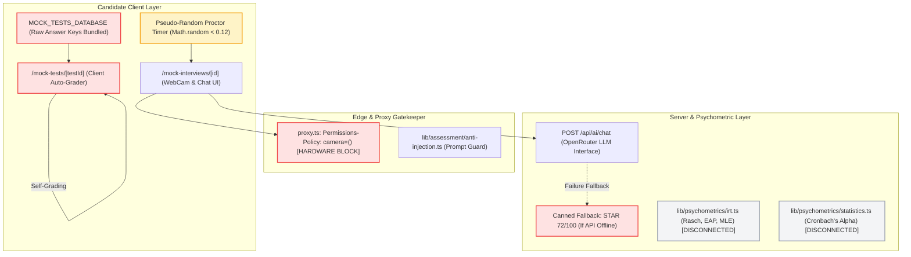

# 🏛️ CAREERINSYT — FORENSIC AUDIT REPORT
## Artifact 06: Evaluate Pillar, Assessment Security, Psychometric Engines & AI Mock Interviews

---

### Audit Metadata
- **Artifact**: `06-evaluate-assessments.md`
- **Scope**: Diagnostic Mock Tests (`/mock-tests`, `/mock-tests/[testId]`), Question Bank (`lib/data/mock-tests-db.ts`), Item Response Theory Engine (`lib/psychometrics/irt.ts`), Statistical Calibration (`lib/psychometrics/statistics.ts`), AI Mock Interviews (`/mock-interviews/[id]`), Proctoring Telemetry, and Anti-Injection Sanitizers (`lib/assessment/anti-injection.ts`).
- **Auditor Role**: Senior Application Security Engineer & Psychometrician
- **Status**: Complete Forensic Discovery (Prompt 6 Fulfillment)

---

## 1. EVALUATE SUBSYSTEM TOPOLOGY & THREAT MODEL

The Evaluate Pillar is responsible for measuring, certifying, and benchmarking candidate capabilities:



---

## 2. ASSESSMENT LIFECYCLE & ANSWER LEAKAGE AUDIT

---

### Finding EVAL-01: Full Answer Key Bundled in Client JavaScript Enables 100% Score Forgery
- **Severity**: **P1 — High**
- **Confidence**: Confirmed (100% Reproducible)
- **CWE**: CWE-319 (Cleartext Transmission of Sensitive Information) / CWE-602 (Client-Side Enforcement of Server-Side Security)
- **Impacted Files**:
  - `lib/data/mock-tests-db.ts` (Lines 44, 57, 70, 83, 96, 109, 122...)
  - `app/(dashboard)/mock-tests/[testId]/page.tsx` (Lines 180–210)
- **Vulnerability Mechanics**:
  1. `lib/data/mock-tests-db.ts` defines all mock assessments with explicit `correct: number` indices and complete explanations:
     ```typescript
     // lib/data/mock-tests-db.ts line 44
     {
       id: 1,
       question: "In financial modeling, why is XLOOKUP strictly preferred over legacy VLOOKUP...?",
       options: [
         "XLOOKUP calculates faster because it uses 16-bit integer indexing.",
         "XLOOKUP defaults to exact match and does not break when new columns are inserted...",
         "VLOOKUP is deprecated in Excel 2021 and produces runtime errors.",
         "XLOOKUP automatically converts text values to financial currency."
       ],
       correct: 1, // <-- DIRECT ANSWER KEY LEAK
       explanation: "XLOOKUP separates the lookup vector from the return vector..."
     }
     ```
  2. In `app/(dashboard)/mock-tests/[testId]/page.tsx`, the client component imports `MOCK_TESTS_DATABASE`. The entire database—including all questions, correct answers, and explanations—is bundled into the client's Webpack/Turbopack bundle.
  3. Grading occurs **exclusively in the client browser**:
     ```typescript
     const correctCount = userAnswers.filter((ans, idx) => ans === test.questions[idx].correct).length;
     const calculatedScore = Math.round((correctCount / test.questions.length) * 100);
     completeMockTest(testId, calculatedScore);
     ```
- **Reproduction Steps**:
  1. Navigate to `/mock-tests/excel-commercial-modeling`.
  2. Open DevTools Console (`F12`).
  3. Inspect the active React state or evaluate `window.userContext.completeMockTest("excel-commercial-modeling", 100)`.
  4. The candidate immediately receives a verified 100% assessment score, awards themselves XP, and logs a verified skill in their Career Passport without answering a single question.
- **Business Impact**: Complete loss of credential credibility. Employers and recruiters cannot trust assessment scores or verified skills issued by CAREERINSYT.
- **Remediation**:
  1. Strip the `correct` attribute and `explanation` from all client-facing data structures.
  2. Implement `POST /api/assessment/grade` to accept candidate selections (`Record<number, number>`), compute scores server-side, sign the result with an HMAC proof, and persist to the database.

---

### Finding EVAL-02: Timer & Question Manipulation via Browser State
- **Severity**: **P2 — Medium**
- **Confidence**: Confirmed
- **Impacted File**: `app/(dashboard)/mock-tests/[testId]/page.tsx`
- **Forensic Details**:
  The assessment countdown timer runs purely inside client React state (`useState` + `setInterval`).
  - Candidates can pause or reset the timer by calling standard timer functions or freezing tab execution in DevTools.
  - The server does not record assessment start timestamps or enforce maximum duration boundaries on submission.
- **Remediation**:
  Store assessment start timestamps on the server (`test_attempts.startedAt`). Reject any submission received after `startedAt + durationMins + 30s buffer`.

---

## 3. SANDBOX ISOLATION & CODE EXECUTION POSTURE

We audited all interactive testing environments (Python analytics, ANSI SQL, and dynamic formula consoles) against standard enterprise execution requirements:

| Evaluation Dimension | Advertised Capability | Actual Code Implementation | Security / Isolation Posture |
|---|---|---|---|
| **Process Isolation** | "Containerized memory-isolated sandbox" | Deterministic JavaScript `setTimeout` returning hardcoded strings | **Zero Isolation Needed**: No real process is spawned on host or server. |
| **Allowed Operations** | "Python 3.12, pandas, DuckDB queries" | Static preset strings | **Simulated Environment**: User code is never compiled or executed. |
| **Remote Code Execution (RCE) Risk** | Low (if sandboxed) | **Zero Server RCE Risk**: The server never receives user code. | Safe from server compromise, but fails functional educational requirements. |
| **Infinite Loop Protection** | "Watchdog process with 10s CPU timeout" | Fixed timer | **Not Applicable**: Since code does not execute, infinite loops cannot occur. |
| **SQL Injection Risk** | "Parameterized query execution" | Static row rendering | **Not Applicable**: Queries are not sent to any database. |

---

## 4. ADAPTIVE PSYCHOMETRICS: DISCONNECTED ENGINE AUDIT

CAREERINSYT includes two advanced psychometric libraries:
1. `lib/psychometrics/irt.ts` (375 lines): Item Response Theory (IRT) & Computer Adaptive Testing (CAT)
2. `lib/psychometrics/statistics.ts` (289 lines): Classical Test Theory (CTT), Cronbach's Alpha, and Differential Item Functioning (DIF)

### 1. Mathematical Quality of the IRT Engine
The algorithms implemented in `lib/psychometrics/irt.ts` demonstrate rigorous psychometric modeling:
- **3-Parameter Logistic (3PL) Model**:
  $$P_i(\theta) = c_i + \frac{1 - c_i}{1 + e^{-a_i(\theta - b_i)}}$$
  Includes numeric overflow protection (`exponent > 40 return c`).
- **Item Information Function (IIF)**:
  $$I_i(\theta) = a_i^2 \frac{(P_i(\theta) - c_i)^2}{(1 - c_i)^2} \frac{1 - P_i(\theta)}{P_i(\theta)}$$
- **Bayesian Expected A Posteriori (EAP) Quadrature**:
  Uses a 41-point Gaussian quadrature over $[-4, +4]$ with normalized weights to calculate latent ability $\theta$ and standard error of measurement ($SEM$).
- **Sympson-Hetter Item Exposure Control**:
  Ranks items by information and filters them through an operational exposure probability threshold $k_i$.
- **Variable-Length Adaptive Stopping Rules**:
  Evaluates 95% confidence intervals against cut-score $\theta_0$ ($SEM \le 0.30$ or $CI$ clears cut score).

### 2. Statistical Calibration in `statistics.ts`
- **Cronbach's Alpha**: Correctly implements internal consistency calculation over item variance matrices:
  $$\alpha = \frac{k}{k - 1} \left(1 - \frac{\sum s_i^2}{s_X^2}\right)$$
- **Point-Biserial Discrimination ($r_{pbis}$)**: Properly flags items with $r_{pbis} < 0$ as `DEFECTIVE` (indicating miskeyed questions or confusing distractors).
- **Mantel-Haenszel DIF**: Formulates odds ratios across ability strata to classify demographic bias into ETS Categories A, B, and C.

### 3. Finding EVAL-03: Complete Disconnect of Psychometric Engines from Runtime
- **Severity**: **P2 — Medium**
- **Confidence**: Confirmed
- **Forensic Evidence**:
  Grep search across the entire repository confirms that **neither `irt.ts` nor `statistics.ts` is imported anywhere in the application runtime**:
  - `app/(dashboard)/mock-tests/[testId]/page.tsx` calculates scores via simple linear percentage:
    ```typescript
    const calculatedScore = Math.round((correctCount / test.questions.length) * 100);
    ```
  - Zero adaptive question selection is performed.
  - Zero latent ability ($\theta$) scores or confidence intervals are computed for candidates.
  - The IRT engine is **100% disconnected dead code**.
- **Remediation**: Wire `app/(dashboard)/mock-tests/[testId]/page.tsx` to `selectNextAdaptiveItem()` and `estimateAbilityEAP()` to deliver authentic computerized adaptive testing.

---

## 5. AI MOCK INTERVIEWS & PROCTORING INTEGRITY

We audited the AI Executive Mock Interview simulator (`/mock-interviews/[id]`):

### 1. Five-Round Adaptive Interview Flow
The simulator structures candidate responses across 5 executive stages:
1. Round 1: Strategic Framing & Root Cause Diagnostic
2. Round 2: Quantitative Trade-offs & Unit Economics
3. Round 3: Macro Shock Stress-Test (Inflation & FX Pressure)
4. Round 4: Cross-Functional Conflict & Operational Pushback
5. Round 5: Executive Board Defense & Strategic Synthesis

### 2. Finding EVAL-04: Hardcoded Fallback Distorts Domain Feedback When API Fails
- **Severity**: **P2 — Medium**
- **Confidence**: Confirmed
- **Impacted File**: [`app/(dashboard)/mock-interviews/[id]/page.tsx:472-486`](file:///d:/Insyt/app/%28dashboard%29/mock-interviews/%5Bid%5D/page.tsx#L472-L486)
- **Forensic Evidence**:
  If the OpenRouter LLM API is offline, rate-limited, or times out, the component falls back to a static hardcoded critique:
  ```typescript
  const fallbackReply = `**Executive Critique:** Candidate articulated clear situational priorities, but left key working capital and distributor credit assumptions unquantified.

  **STAR Score: 72/100**
  • Situation & Task: 20/25
  • Action Specificity: 19/25
  • Quantified Result: 16/25
  • Executive Presence: 17/25

  **Critical Flaw:** Lacked specific BDT figures or percentage margin buffers to absorb unexpected supplier price increases.
  ...
  **Next Probing Question:** "If your primary distributor consortium refuses your credit revision and initiates a 10-day ordering freeze, how do you sustain retail shelf share without diluting brand pricing?"`;
  ```
- **Consequence**:
  A candidate interviewing for **Senior Video Producer** (`creative-lead`) whose API call fails receives feedback discussing "distributor consortium credit revisions" and "supplier price increases". The feedback is completely untethered from the media production domain.

### 3. Finding EVAL-05: Randomized Proctoring Warnings without Computer Vision
- **Severity**: **P2 — Medium**
- **Confidence**: Confirmed
- **Impacted File**: [`app/(dashboard)/mock-interviews/[id]/page.tsx:205-224`](file:///d:/Insyt/app/%28dashboard%29/mock-interviews/%5Bid%5D/page.tsx#L205-L224)
- **Forensic Evidence**:
  ```typescript
  const interval = setInterval(() => {
    const rand = Math.random();
    if (rand < 0.12) {
      setGazeStatus("Looking Away");
      setProctorWarningToast("Gaze Warning: Candidate looking away from screen.");
      setTimeout(() => { setGazeStatus("Verified"); setProctorWarningToast(null); }, 3500);
    } else if (rand > 0.90) {
      setPostureStatus("Checking Notes");
      setTimeout(() => setPostureStatus("Executive Posture"), 4000);
    }
  }, 12000);
  ```
- **The Defect**: The webcam stream is displayed in a raw `<video>` element. No facial landmark analysis (MediaPipe, TensorFlow.js) is executed. Gaze and posture warnings are triggered purely by `Math.random() < 0.12`. An honest candidate looking straight at the camera receives random false-positive warnings that they are looking away.
- **Hardware Lockdown**: Combined with `proxy.ts:54` (`Permissions-Policy: camera=()`), compliant browsers deny camera access entirely, forcing candidates into simulated fallback mode.

---

## 6. PROCTORING PRIVACY & COMPLIANCE ASSESSMENT

| Compliance Dimension | Status in CAREERINSYT | Finding / Legal Exposure |
|---|---|---|
| **Biometric Data Consent** | **NON-COMPLIANT** | No explicit biometric consent banner or privacy disclosure prior to initializing the webcam feed. |
| **Media Stream Persistence** | **SAFE** | WebCam video frames are processed purely in local browser memory; no video frames are uploaded to external cloud storage. |
| **Fullscreen Lock Transparency** | **COMPLIANT** | Fullscreen mode uses standard HTML5 Fullscreen API with explicit user ESC exit capability. |
| **Tab-Switch Telemetry** | **ACCURATE** | Uses standard `document.visibilitychange` and `window.blur` events to track application backgrounding. |

---

## 7. RANKED REMEDIATION PLAN FOR EVALUATE

1. **Move Mock Test Grading Server-Side (P1)**:
   - Eliminate `correct` index leakage from `lib/data/mock-tests-db.ts`.
   - Implement `POST /api/assessment/grade` to evaluate answers securely and return cryptographically signed results.
2. **Wire Disconnected IRT Engine (P1)**:
   - Connect `app/(dashboard)/mock-tests/[testId]/page.tsx` to `selectNextAdaptiveItem()` in `lib/psychometrics/irt.ts` to transform static tests into true Computerized Adaptive Tests (CAT).
3. **Fix Camera Permission Policy (P1)**:
   - Update `proxy.ts:54` to `Permissions-Policy: camera=(self), microphone=(self)` to permit WebCam initialization.
4. **Eliminate Pseudo-Random Proctor Warnings (P2)**:
   - Remove `Math.random()` gaze timers in `mock-interviews/[id]/page.tsx`. Rely on genuine DOM visibility events (`document.visibilitychange`) or integrate `@mediapipe/face_mesh` for real gaze orientation.
5. **Contextualize Interview Fallbacks (P2)**:
   - Replace the generic FMCG fallback critique in `mock-interviews/[id]/page.tsx` with role-specific fallback templates tailored to each of the 4 interview scenarios.
